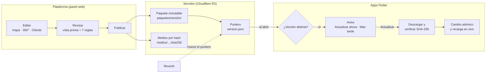
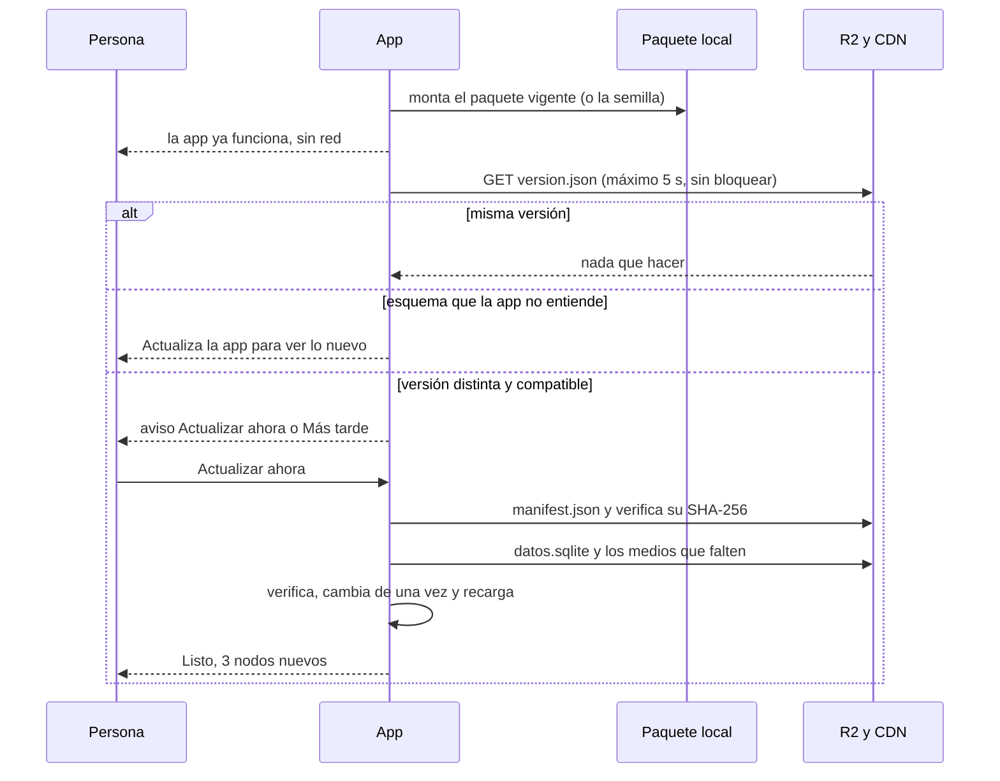

# Flujo de actualización (plataforma → apps)

> [!abstract] En una frase
> Lo que se edita en la **plataforma** llega a **todas las apps** (Android, web y Windows; después macOS e iOS) como un **paquete de datos versionado**. La app lo descarga cuando la persona acepta, lo verifica y lo cambia de una sola vez. **Nunca se recompila la app para cambiar contenido**, y si algo sale mal se revierte en segundos.

> [!info] Estado (5 de noviembre de 2026)
> - **Servidor: ya existe.** Publicar, paquete inmutable en R2, puntero `version.json` y revertir.
> - **Apps: falta.** El lector del paquete, el aviso y la descarga, y algunos refuerzos del servidor.
>
> El orden para hacerlo está en [[#9. Plan de implementación (para después)]], y el detalle con tareas y pruebas en [[Plan de trabajo - actualizaciones]]. Esta nota **no cambia código**: es el plano para construirlo sin errores.

---

## 1. El recorrido completo



1. **Editar** en la plataforma: nodos, rutas, fotos 360° y sus puntos, espacios, horarios y el apartado **Cliente** (apariencia, páginas y minimapa).
2. **Revisar**: vista previa de cada editor y las 7 reglas de validación.
3. **Publicar**: se construye `datos.sqlite`, se sube el paquete a `paquetes/<versión>/` y **al final** se mueve el puntero `version.json`.
4. **Avisar**: cada app, al abrirse con red, ve que la versión cambió y pregunta.
5. **Descargar y verificar**: solo lo nuevo (los medios van por hash) y con SHA-256.
6. **Cambiar** de una sola vez y refrescar la pantalla sin reiniciar.
7. **Revertir**: mover el puntero a una versión anterior. Las apps la reciben igual que una nueva.

---

## 2. Tres tipos de cambio (la clave para no tener errores)

| Tipo | Ejemplos | Cómo llega a la gente | ¿Nueva versión de la app? | Tiempo |
|---|---|---|---|---|
| **Contenido** (el paquete) | Nodos, rutas, espacios, horarios, panorámicas, puntos 360°, anuncios, **apariencia y páginas del apartado Cliente**, nodos del minimapa | Publicar → aviso en la app | **No** | Minutos |
| **Medios** | Fotos 360° (rápida y alta), imágenes, GIF, videos | Con el paquete, por hash: solo se baja lo nuevo | **No** | Según el tamaño |
| **Código de la app** | Pantalla nueva, nuevo tipo de elemento o de punto, cambio de esquema | Nueva versión: tienda o instalador; en la web, un despliegue nuevo | **Sí** | Horas a días (tiendas) |
| **Código de la plataforma** | Mejoras del panel | Despliegue en Vercel | No afecta a las apps | Minutos |

> [!tip] Regla de oro
> Si algo se puede decidir con **datos**, va en el paquete. Así casi todos los cambios llegan sin pasar por las tiendas. Lo único que exige una versión nueva de la app es **código nuevo** (por ejemplo, una forma de punto que la app todavía no sabe dibujar).

---

## 3. El contrato de versiones

### Tres números que no se deben confundir

| Número | Ejemplo | Quién lo pone | Para qué |
|---|---|---|---|
| **Versión del paquete** | `2026.11.05-1430` | La plataforma, al publicar | Saber si hay algo nuevo (el orden alfabético es el cronológico) |
| **`esquema_version`** | `3` | El equipo, en el código | La estructura de `datos.sqlite`. Sube **solo** si un cambio rompe a las apps viejas |
| **Versión de la app** | `1.4.0+12` | El equipo, en `pubspec.yaml` | Tiendas e instaladores. El `+12` (número de compilación) **siempre crece** |

### Reglas de compatibilidad

1. **Lo aditivo no rompe.** Columnas, tablas o campos JSON nuevos no suben el esquema: la app **ignora lo que no conoce** (lector tolerante).
2. **Lo que rompe sube el esquema.** Renombrar o borrar columnas, o cambiar el significado de un dato, sube `esquema_version`.
3. **Cada app declara qué esquemas entiende** (por ejemplo `3..3`). Si `version.json` trae uno que no entiende, **no descarga**: sigue con su paquete y muestra «Actualiza la app para ver lo nuevo», con el enlace a su tienda.
4. **`app_minima` por plataforma** sirve para los casos finos, por ejemplo un tipo de elemento nuevo en las páginas que una app vieja no sabe dibujar.
5. **Lo desconocido se omite.** Si la apariencia trae un `tipo` de elemento, una `forma` o una `animacion` que la app no conoce, la app **lo salta sin fallar**.
6. **Se compara por «distinta», no por «mayor».** Si la plataforma revierte, el puntero apunta a una versión más vieja y la app debe ofrecerla igual.
7. **Hoy `esquema_version` viaja como texto** (`"3"`). La app debe aceptar texto o número.

### `version.json`: lo que hay hoy y lo que se agrega

```json
{
  "version": "2026.11.05-1430",
  "campus_id": "santa-lucia",
  "generado": "2026-11-05T19:30:00.000Z",
  "esquema_version": "3",
  "manifiesto": "https://datos.unipaz360.app/paquetes/2026.11.05-1430/manifest.json",
  "sha256": "<hash del manifest.json>",
  "tamano_bytes": 18450211,
  "archivos": 42,
  "notas": "Fotos nuevas del Bloque 3",

  "canal": "estable",
  "app_minima": { "android": "1.0.0", "web": "1.0.0", "windows": "1.0.0", "macos": "1.0.0", "ios": "1.0.0" },
  "resumen": { "nodos": 3, "panoramicas": 5, "paginas": 1 },
  "firma": "<Ed25519 del manifiesto>"
}
```

- **Ya existen:** los campos del primer bloque (también `campus` y `contenido_sha256`).
- **Se agregan:** `canal`, `app_minima`, `resumen` y, en la fase de refuerzo, `firma`.
- La app nunca debe fallar si falta uno de los campos nuevos.

---

## 4. El servidor (qué hay en R2)

```
version.json                        ← puntero del canal estable (no-cache)
pruebas/version.json                ← puntero del canal de pruebas (no-cache) · por hacer
paquetes/<versión>/datos.sqlite     ← inmutable (caché de 1 año)
paquetes/<versión>/manifest.json    ← lista de archivos con bytes, SHA-256 y URL
paquetes/<versión>/version.json     ← copia, para poder revertir
medios/<carpeta>/<sha256>.<ext>     ← inmutables y compartidos entre versiones
```

> [!success] Ya implementado en la plataforma
> - El paquete es inmutable y el puntero se mueve **de último**, así la app nunca ve un paquete a medias.
> - Los medios se nombran por su hash y se suben con `Cache-Control: public, max-age=31536000, immutable`.
> - `version.json` se sirve con `no-cache`.
> - Revertir = mover el puntero.

- **Descarga diferencial.** `datos.sqlite` pesa poco (cientos de KB) y se baja completo. Los medios se identifican por su SHA-256, así que **solo se descargan los que no están**.
- **Retención.** Se guardan las últimas 20 versiones y todos los medios que ellas citan. Lo huérfano se limpia a los 30 días (tarea de refuerzo).
- **Canal de pruebas.** «Publicar a pruebas» mueve `pruebas/version.json`. «Promover a estable» mueve `version.json` al **mismo** paquete, sin reconstruirlo. Es la misma idea de vista previa → promover de Vercel.

> [!warning] Antes de que las apps descarguen de verdad
> 1. **Dominio propio para los datos** (por ejemplo `datos.unipaz360.app` en Cloudflare). Hoy se usa `pub-….r2.dev`, que Cloudflare limita y no recomienda para producción.
> 2. **CORS del bucket.** Correr `node panel/scripts/configurar-r2.mjs` (sigue pendiente desde noviembre). Sin esto la **app web** no puede leer `version.json`, el paquete ni las imágenes. Además hay que permitir el encabezado `Range` y exponer `Content-Length` y `Content-Range` para las descargas reanudables.
> 3. **Candado al publicar** (`pg_advisory_xact_lock` en Neon). Hoy, dos publicaciones al mismo tiempo podrían pisarse el puntero.

---

## 5. La app: el motor de actualización (`core/paquete`)

### Al abrir la app



### Pasos de «Actualizar ahora»

1. Descargar `manifest.json` y comprobar que su SHA-256 es el que dice `version.json`.
2. Calcular cuánto hay que bajar con los bytes del manifiesto. Si no hay espacio, se avisa **sin tocar lo actual**.
3. Descargar `datos.sqlite` a `descargas/` (reanudable con `Range`) y verificar su SHA-256 leyéndolo por partes.
4. Abrirlo y revisarlo: `PRAGMA integrity_check`, que `metadatos.version` sea la versión esperada y que el esquema sea soportado.
5. Descargar los medios que falten según la política de medios, cada uno verificado por su hash.
6. **Cambio atómico.** Se escribe el puntero local `actual.json` (archivo temporal + renombrar). Nunca se renombra una carpeta que esté abierta, porque en Windows falla.
7. **Recarga en vivo.** Datos, apariencia, páginas y minimapa se refrescan sin reiniciar la app.
8. **Si cualquier paso falla**, se borra `descargas/`, se conserva el paquete vigente y se dice qué pasó con palabras simples. El paquete anterior queda guardado para volver atrás.

### Carpetas en el dispositivo

```
<datos de la app>/unipaz360/
├── actual.json            ← { "version": "2026.11.05-1430" } (el puntero local)
├── paquetes/<versión>/    ← datos.sqlite + manifest.json (el vigente y el anterior)
├── descargas/             ← lo que se está bajando (se borra si falla)
├── medios/<sha256>.<ext>  ← caché compartida por hash
└── estado.json            ← último chequeo, versión pospuesta y política de medios
```

> [!note] Cambio respecto al plan anterior
> Reemplaza a `paquete-actual/` y `paquete-anterior/` de [[Datos y publicación]]. Cambiar un **archivo puntero** es atómico en todas las plataformas. Renombrar carpetas no lo es cuando la base está abierta (sobre todo en Windows). Al arrancar, se borran las versiones que no sean la vigente ni la anterior.

### Primera vez sin internet: el paquete semilla

- La app trae dentro un paquete completo (`assets/paquete/`): el último publicado en el canal estable al momento de compilar. Así funciona **desde el primer segundo**, incluso en modo avión.
- El CI lo descarga antes de compilar (`scripts/semilla.mjs`, por hacer), verifica su SHA-256 y lo empaqueta.
- Los recursos `app://imagenes/…` y `app://videos/…` de las páginas siguen viniendo en `assets/` (ver `docs/datos/apariencia-app.md`).

### Política de medios (decisión ya tomada en [[Cliente Flutter]])

| Ajuste | Qué baja |
|---|---|
| **Solo datos básicos** (por defecto) | `datos.sqlite`, la versión rápida de cada 360° y las imágenes de las páginas y del minimapa |
| **Descargar todo (Wi-Fi)** | Además, la versión alta de los 360° y los videos |
| **Borrar medios** | Libera espacio; se vuelven a bajar cuando se necesiten |

- En datos móviles se pregunta antes de bajar más de 50 MB.
- Los tamaños salen del manifiesto, así la persona ve cuánto ocupa antes de aceptar.
- Si una foto alta todavía no está, se muestra la rápida mientras tanto.

### El aviso (decisión ya tomada ✅)

- Se muestra **cada vez que se abre** la app mientras haya una versión distinta. «Más tarde» solo pospone hasta la próxima apertura. **Nunca se actualiza en silencio.**
- Dice qué cambió (las `notas` y el `resumen`: «3 nodos nuevos, fotos del Bloque 3») y cuánto pesa.
- No necesitan aviso los anuncios que vencen: la app los filtra con su fecha.

---

## 6. Cada plataforma

| | Android | Web | Windows | macOS (después) | iOS (después) |
|---|---|---|---|---|---|
| **Dónde guarda** | Carpeta de soporte de la app (`path_provider`) | IndexedDB, o OPFS si el hosting envía COOP/COEP | `%LOCALAPPDATA%` (`getApplicationCacheDirectory`), no la carpeta *Roaming* | *Application Support* (sandbox) | *Application Support*, marcado para **no** ir al respaldo de iCloud |
| **SQLite** | `sqlite3` + `sqlite3_flutter_libs` (o drift) | `sqlite3` en WASM (o drift `WasmDatabase`) | `sqlite3.dll` empaquetado | Incluido | Incluido |
| **Sin conexión** | Total | Con un *service worker* propio (Workbox) que guarda la app, el paquete y los medios | Total | Total | Total |
| **Actualizar el contenido** | Paquete (esta nota) | Paquete | Paquete | Paquete | Paquete |
| **Actualizar la app** | Google Play (In-App Updates), o Firebase App Distribution para pruebas | Desplegar de nuevo; el *service worker* avisa «Hay una versión nueva, recargar» | MSIX con archivo `.appinstaller`, que busca actualizaciones al abrir | App Store, o fuera de ella firmada y notarizada | App Store, con TestFlight para pruebas |
| **Ojo con** | Permiso `INTERNET` en el manifiesto principal (✅ ya está) · `versionCode` siempre crece | CORS de R2 · el *service worker* que generaba Flutter quedó en desuso: se usa uno propio | Certificado para firmar el MSIX · no renombrar carpetas abiertas | Agregar `com.apple.security.network.client` en Debug **y** en Release (la plantilla no lo trae) | Solo HTTPS (✅) · Apple permite bajar **datos**, no código (guía 2.5.2) |

> [!note] La web es distinta
> En la web, la app misma se actualiza al desplegarla: no hay tienda. El contenido sigue el mismo camino del paquete, pero guardado en el navegador.

---

## 7. Cómo trabajamos de aquí en adelante

### Contenido (lo de todos los días)

1. **Editar** en https://unipaz360-panel.vercel.app (mapa, 360° y Cliente).
2. **Revisar** con la vista previa de cada editor y «Probar como visitante» en Cliente. La tarjeta *Cambios sin publicar* resume lo pendiente.
3. **Publicar al canal de pruebas**, con notas claras («Fotos nuevas del Bloque 3»).
4. **Probar** en un celular Android, un PC con Windows y el navegador, marcados como «pruebas» (ajuste oculto: tocar 7 veces la versión en *Ajustes*).
5. **Promover a estable**: el mismo paquete pasa al puntero de todos.
6. Las apps avisan y la gente actualiza.
7. ¿Algo salió mal? **Revertir** en Publicación → Historial (segundos).

### Código

| Qué | Rama | Cómo sale |
|---|---|---|
| Plataforma (panel) | `plataforma` → PR → `main` | Vercel. ⏳ Depende de la decisión **D10** (abajo) |
| App Flutter | `main` (ramas cortas por historia de usuario) | Etiqueta `app-vX.Y.Z` → el CI compila Android, Windows y web → pruebas → tiendas, instalador o despliegue |
| Esta documentación | `informativa` | Push |

> [!important] Orden cuando cambia el contrato
> Antes de subir `esquema_version` o `app_minima`, **primero** se publica la app nueva en todas las plataformas y **después** el contenido que la necesita. Al revés, la gente se queda con un aviso que no puede atender.

---

## 8. Qué puede salir mal y cómo se evita

| Situación | Qué pasa | Protección |
|---|---|---|
| Sin internet al abrir | La app funciona con su paquete | El chequeo se salta |
| Se corta la descarga | Se reintenta o se reanuda | `descargas/` aparte y `Range` |
| Archivo dañado o alterado | Se descarta | SHA-256 de cada archivo, `integrity_check` y, en refuerzo, firma |
| Se publica un dato malo | No sale si viola una regla | 7 reglas + canal de pruebas + **Revertir** |
| App vieja con esquema nuevo | Sigue con lo que tiene | Aviso «Actualiza la app» |
| Poco espacio | No se toca lo actual | Se calcula con el manifiesto antes de bajar |
| Falla la subida a R2 al publicar | Nadie lo ve | El puntero se mueve al final (✅ ya está) |
| El CDN guarda un `version.json` viejo | La app no ve lo nuevo | `no-cache` y `?t=<hora>` en la consulta |
| Dos personas publican a la vez | Podrían pisarse | Candado en Neon (por hacer) |
| La web sin CORS | No carga nada | Configurar el bucket (por hacer) |
| Un medio borrado de R2 | Imagen faltante | Regla 5 y no borrar medios citados por versiones retenidas |
| Reloj del dispositivo mal puesto | — | Las versiones se comparan por texto, no por hora |
| Compilación de *release* sin red (Android, macOS) | No descarga | Checklist de cada plataforma (sección 6) |
| La plataforma revierte | Las apps quedan con la versión mala | Comparar por «distinta», no por «mayor» |

---

## 9. Plan de implementación (para después)

> [!todo] Orden recomendado
> Cada fase se termina y se prueba antes de pasar a la siguiente. Tareas, archivos y pruebas de cada fase: [[Plan de trabajo - actualizaciones]].

| Fase | Qué se hace | Está lista cuando… |
|---|---|---|
| **A · Servidor para las apps** | Dominio propio para los datos · CORS con `Range` · candado al publicar · `canal`, `app_minima` y `resumen` en `version.json` · regla «apariencia válida» | Desde otro dominio se lee todo con `curl`, y dos publicaciones al tiempo no se pisan |
| **B · Núcleo en Flutter** | `core/paquete`: leer `datos.sqlite` (deja de usarse `repositorio_simulado`), semilla, `actual.json`, verificación SHA-256, reversión local | Pasan las pruebas: archivo dañado, sin espacio, corte de red, esquema nuevo y reversión |
| **C · Aviso y ajustes** | `features/actualizaciones`: aviso, progreso, resumen de cambios y política de medios | Funciona de punta a punta contra el canal de pruebas |
| **D · Plataformas** | Android (firma y AAB) · crear `app/windows` y su MSIX · web con *service worker* propio · después macOS e iOS | Las tres obligatorias se actualizan solas desde la plataforma |
| **E · Canal de pruebas** | En el panel, «Publicar a pruebas» y «Promover a estable»; en la app, el ajuste oculto | Un cambio se prueba en dispositivos antes de que lo vean todos |
| **F · Apariencia en Flutter** | Dibujar `configuracion_app`: barra, minimapa (3 estados), páginas (lienzo de 1000) y puntos 360° (formas y animaciones) | La app se ve igual que la vista previa del apartado Cliente |
| **G · Refuerzo** | Firma Ed25519 del manifiesto · limpieza de versiones viejas · métricas anónimas de adopción (opcional, Ley 1581) | — |

**Pruebas que no pueden faltar (fase B):** paquete con SHA-256 malo · `datos.sqlite` corrupto · sin espacio · corte a la mitad y reanudar · esquema más nuevo · reversión desde el servidor · arranque en modo avión con la semilla · dos actualizaciones seguidas sin reiniciar.

---

## 10. Decisiones

| # | Decisión | Estado |
|---|---|---|
| — | Aviso **[Actualizar ahora] / [Más tarde]**, nunca en silencio | ✅ Tomada |
| D4 | Paquete SQLite + manifiesto, medios por hash | ✅ Tomada e implementada en la plataforma |
| D10 | ¿La producción del panel sale al fusionar a `main` o directo de cada push a `plataforma`? | ⏳ Pendiente (recomendado: al fusionar a `main`, que es lo que planteaba [[Arquitectura general]]) |
| D11 | Dominio propio para los datos (`datos.unipaz360.app` u otro) | ⏳ Pendiente (cabe en el presupuesto de dominio de la [[Hoja de ruta]]) |
| D12 | Identificador definitivo de la app: hoy es `co.edu.unipaz.dam.unipaz360`, y no se puede cambiar después de publicar en Google Play | ⏳ Pendiente (recomendado: `co.edu.unipaz.unipaz360`, sin «dam») |
| D13 | Distribución en Windows: Microsoft Store o MSIX propio con `.appinstaller` | ⏳ Pendiente |
| D14 | ¿Canal de pruebas desde el primer día? | ⏳ Recomendado: sí |

> [!quote] A futuro
> Con varias sedes, cada campus tendrá su puntero (`campus/<id>/version.json`). Todo ya lleva `campus_id`, así que no hay que rehacer nada.

Relacionado: [[Plan de trabajo - actualizaciones]] · [[Datos y publicación]] · [[Cliente Flutter]] · [[Plataforma de administración]] · [[Arquitectura general]] · [[Marca y logo]] · [[Hoja de ruta]] · [[Bitácora del repositorio]]

Volver a [[00 Sistema - Índice]] · [[00 UniPaz360 - Índice]]
