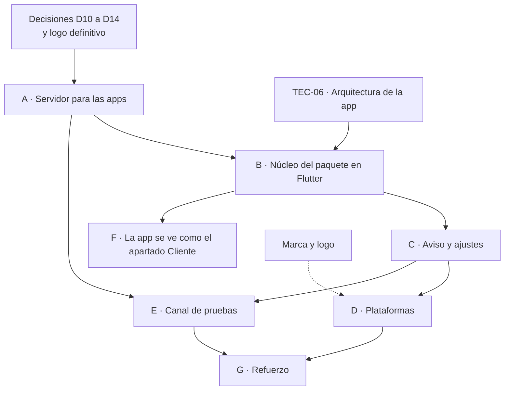

# Plan de trabajo: actualizaciones a las apps

> [!abstract] Para qué es esta nota
> Es el paso a paso para construir lo que describe [[Flujo de actualización (plataforma → apps)]]: qué tareas, en qué orden, qué archivos se tocan, cómo se prueba cada cosa y cuándo está terminada.
> **Nada de esto está empezado todavía.** Se marca aquí a medida que se avance.

---

## Mapa de fases

| Fase | Dónde | Tamaño aproximado | Tablero |
|---|---|---|---|
| A · Servidor para las apps | Plataforma y R2 | S | TEC-07 (#24) |
| B · Núcleo del paquete | App | L | TEC-06 (#19), TEC-02 (#2), HU-09 (#13) |
| C · Aviso y ajustes | App | M | HU-09 (#13) |
| D · Plataformas | App y CI | L | TEC-03 (#6) |
| E · Canal de pruebas | Plataforma y app | S | Propuesta HU-31 |
| F · Apariencia en Flutter | App | L | HU-26 (#47), HU-27 (#48) |
| G · Refuerzo | Plataforma y app | M | — |

*Tamaños: S ≈ 1 a 3 días · M ≈ 1 semana · L ≈ 2 semanas o más.*

> [!note] Va junto con [[Plan de trabajo - guía y chatbot]]
> El motor de rutas (R1) y el del asistente (H1) se hacen al tiempo con las fases A y B. El chat en la app (H2) llega cuando B esté lista.

---

## Antes de empezar: lo que destraba el trabajo

- [ ] **D10** · ¿La producción del panel sale al fusionar a `main` o directo de `plataforma`?
- [ ] **D11** · Dominio para los datos: comprarlo y apuntar `datos.<dominio>` al bucket en Cloudflare.
- [ ] **D12** · Identificador definitivo de la app, antes de la primera publicación en Google Play.
- [ ] **D13** · Windows: Microsoft Store o MSIX propio.
- [ ] **D14** · ¿Canal de pruebas desde el primer día?
- [ ] **Logo** definitivo → [[Marca y logo]].

---

## Fase A · Servidor listo para las apps

> Casi todo ya existe en la plataforma: aquí se termina y se blinda.

**Tareas**
- [ ] **Dominio propio** para R2 con la caché de Cloudflare. Cambiar `R2_PUBLIC_URL` en Vercel (Preview y Production) y en el archivo de secretos local.
- [ ] **Migrar las URL guardadas** con un script de una sola vez: `medio.url_publica` y los enlaces `https` de `configuracion_app`. Mientras tanto, `r2.dev` sigue encendido para que nada se rompa.
- [ ] **CORS**: actualizar `panel/scripts/configurar-r2.mjs` para permitir el encabezado `range` y exponer `Content-Length`, `Content-Range` y `ETag`; luego correrlo. Para `GET` sirve cualquier origen (son datos públicos); `PUT` se puede limitar al dominio del panel.
- [ ] **Candado al publicar y al revertir**: `pg_advisory_xact_lock` en `panel/src/lib/publicacion.ts`.
- [ ] **`version.json` v2**: `canal`, `app_minima` y `resumen`. La versión mínima por plataforma se edita en Publicación (migración `0005`, tabla de ajustes de publicación).
- [ ] **Regla nueva «apariencia válida»**: que cada `https` de `configuracion_app` sea un medio existente, que cada `app://` esté en la lista de recursos de la app y que los «Ir a» apunten a panorámicas publicadas.
- [ ] **Documentar** el contrato v2 en `docs/datos/formato-paquete.md`.

**Pruebas**
- [ ] `curl -I -H "Origin: https://app.ejemplo" https://datos.<dominio>/version.json` devuelve `Access-Control-Allow-Origin`.
- [ ] Dos publicaciones al mismo tiempo: una espera a la otra y `version.json` queda con la última.
- [ ] `node scripts/pruebas.mjs` sigue en verde.

**Está lista cuando:** desde otro dominio se lee `version.json`, el manifiesto, el paquete y un medio, y ninguna URL vieja dejó de funcionar.

---

## Fase B · Núcleo del paquete en Flutter

> **Prerrequisito:** ordenar `app/lib` en `core/` y `features/` (TEC-06; ver [[Visión consolidada (nov-2026)]], sección 4).

**Tareas**
- [ ] Dependencias: `sqlite3` + `sqlite3_flutter_libs` (o `drift`), `path_provider`, `crypto` y `http` (respuestas por partes para el progreso y `Range` para reanudar).
- [ ] `core/paquete/almacen.dart`: dónde guardar en cada plataforma, con importaciones condicionales (`AlmacenIo` para Android, Windows, macOS e iOS; `AlmacenWeb` para IndexedDB).
- [ ] `core/paquete/puntero.dart`: leer y escribir `actual.json` de forma atómica (archivo temporal + renombrar).
- [ ] `core/paquete/verificador.dart`: SHA-256 leyendo por partes, sin cargar el archivo entero en memoria.
- [ ] `core/paquete/descargador.dart`: progreso, `Range`, reintentos con espera creciente (1, 2 y 4 s) y cancelación.
- [ ] `core/paquete/actualizador.dart`: la máquina de estados `inactivo → consultando → hay_version → descargando → verificando → aplicando → listo | error`.
- [ ] `core/datos/base_paquete.dart`: abrir `datos.sqlite` en solo lectura y los repositorios (espacios, vértices, tramos, panorámicas, puntos y configuración).
- [ ] Reemplazar `repositorio_simulado.dart` por los repositorios del paquete, por partes y con pruebas.
- [ ] **Semilla**: `app/assets/paquete/`. En el primer arranque se copia al almacén si no hay puntero.
- [ ] `scripts/semilla.mjs` (en el repo): baja el paquete estable, lo verifica y lo deja en `app/assets/paquete/`.
- [ ] Limpieza al arrancar: borrar las versiones que no sean la vigente ni la anterior, y la carpeta `descargas/` huérfana.

**Pruebas** (unitarias, con un servidor falso)
- [ ] SHA-256 malo → se descarta y se conserva el vigente.
- [ ] `datos.sqlite` corrupto → falla `integrity_check` → se descarta.
- [ ] Sin espacio → no descarga y lo dice.
- [ ] Corte a la mitad → reanuda con `Range`.
- [ ] Esquema 4 en una app que entiende el 3 → aviso «Actualiza la app».
- [ ] La plataforma revierte (versión más vieja) → la app ofrece cambiar.
- [ ] Modo avión en el primer arranque → funciona con la semilla.
- [ ] Dos actualizaciones seguidas sin reiniciar.

**Está lista cuando:** la app lee todo desde `datos.sqlite`, se actualiza contra un paquete de prueba y pasan los 8 casos.

---

## Fase C · Aviso y ajustes

**Tareas**
- [ ] `features/actualizaciones/aviso.dart`: hoja con las notas, el resumen y el tamaño, y los botones **[Actualizar ahora]** / **[Más tarde]**.
- [ ] Progreso con porcentaje, botón para cancelar y errores en palabras simples.
- [ ] *Ajustes → Datos y descargas*: «Solo datos básicos», «Descargar todo (Wi-Fi)» y «Borrar medios», con los tamaños a la vista.
- [ ] Preguntar antes de bajar más de 50 MB con datos móviles (`connectivity_plus`).
- [ ] Recarga en vivo: los proveedores de estado se refrescan al cambiar el puntero.
- [ ] Accesible: lector de pantalla, contraste y textos del sistema (WCAG 2.2 AA).

**Pruebas:** pruebas de *widgets* del aviso y una prueba de punta a punta contra el canal de pruebas.

**Está lista cuando:** una persona actualiza desde el aviso sin ayuda y, si dice «Más tarde», el aviso vuelve en la siguiente apertura.

---

## Fase D · Plataformas

**Android**
- [ ] Firma de *release* con el *keystore* guardado fuera del repositorio (en el gestor del equipo), y compilación AAB.
- [ ] Confirmar el permiso `INTERNET` en *release* (✅ ya está en el manifiesto principal).
- [ ] Firebase App Distribution para pruebas (TEC-03); después Google Play con In-App Updates.

**Windows**
- [ ] Crear la carpeta: `flutter create --platforms=windows .` dentro de `app/`.
- [ ] Probar `sqlite3.dll` y las rutas en `%LOCALAPPDATA%`.
- [ ] MSIX con el paquete `msix` y su certificado; si D13 es «MSIX propio», publicar el `.appinstaller` en R2.

**Web**
- [ ] Hosting con dominio (Vercel o Cloudflare Pages).
- [ ] SQLite en WASM (`sqlite3.wasm` en `web/`) y el almacén en IndexedDB.
- [ ] *Service worker* propio (Workbox): guarda la app, el paquete y los medios, y avisa «Hay una versión nueva de la app».
- [ ] Probar el CORS real contra el dominio de los datos.

**macOS e iOS** (cuando haya un Mac o un CI con macOS)
- [ ] `flutter create --platforms=macos,ios .`
- [ ] macOS: `com.apple.security.network.client` en Debug y en Release.
- [ ] iOS: marcar `medios/` para que no vaya al respaldo de iCloud.
- [ ] Firmas, TestFlight y notarización.

**CI de la app (GitHub Actions)**
- [ ] Flujo `app.yml`: con la etiqueta `app-vX.Y.Z` corre `flutter analyze`, las pruebas y la semilla, y compila Android (AAB y APK), Windows (MSIX) y web; adjunta todo al *release*.

**Está lista cuando:** las tres plataformas obligatorias se instalan, abren sin red y se actualizan desde la plataforma.

---

## Fase E · Canal de pruebas

- [ ] Panel: botones «Publicar a pruebas» y «Promover a estable» en Publicación, con auditoría.
- [ ] R2: puntero `pruebas/version.json`.
- [ ] App: ajuste oculto (7 toques en la versión) para usar el canal de pruebas, con una etiqueta **PRUEBAS** visible mientras esté activo.
- [ ] Historial: mostrar en qué canal está cada versión.

**Está lista cuando:** un cambio se prueba en un celular, un PC y el navegador antes de que lo vea todo el mundo.

---

## Fase F · La app se ve como el apartado Cliente

- [ ] Leer `configuracion_app` (clave `app`) y normalizarla con las mismas reglas de `normalizarConfig`, probada con los mismos casos.
- [ ] Encabezado, barra lateral y riel con las medidas de `docs/datos/apariencia-app.md`.
- [ ] Páginas: `Stack` + `Positioned` escalados por `k`. Texto (Roboto y Noto Serif empaquetadas), imagen, botón, forma, video y mapa, con sus enlaces.
- [ ] Minimapa: lámina con los nodos, estados minimizado, normal y maximizado (`InteractiveViewer` al maximizar) e ir al nodo al tocarlo.
- [ ] Puntos 360°: 8 formas, color, tamaño, 9 animaciones, corrección de horizonte y flecha en el piso (`docs/datos/puntos-360.md`).
- [ ] Prueba de fidelidad: capturas del panel contra capturas de la app al mismo tamaño (*golden tests*).

**Está lista cuando:** la app y la vista previa del apartado Cliente se ven igual en celular, Windows y web.

---

## Fase G · Refuerzo

- [ ] Firma Ed25519: la clave privada en Vercel y la pública dentro de la app. La app rechaza un manifiesto sin firma válida.
- [ ] Limpieza programada: se guardan 20 versiones; los medios huérfanos se borran a los 30 días.
- [ ] Métricas anónimas de adopción (versión instalada por plataforma), opcionales y con aviso de privacidad (Ley 1581).

---

## Propuesta para el tablero (todavía no creadas en GitHub)

| ID | Título | Fase |
|---|---|---|
| TEC-13 | Servidor listo para las apps: dominio, CORS, candado y `version.json` v2 | A |
| TEC-14 | Núcleo del paquete en Flutter: almacén, puntero, verificación y semilla | B |
| TEC-15 | Windows: carpeta `app/windows` y MSIX | D |
| TEC-16 | Web: hosting, SQLite en WASM y *service worker* propio | D |
| TEC-17 | CI de la app: compilar Android, Windows y web con cada etiqueta | D |
| TEC-18 | Canal de pruebas: publicar a pruebas y promover a estable | E |
| TEC-19 | Marca: archivos maestros y generación de íconos | Marca |
| HU-28 | Como visitante, quiero ver las páginas de cada sección igual que en el apartado Cliente | F |
| HU-29 | Como visitante, quiero minimizar, ver normal o maximizar el minimapa y tocar un nodo para ir allí | F |
| HU-30 | Como visitante, quiero ver los puntos de las fotos 360° con sus formas, colores y animaciones | F |
| HU-31 | Como administrador, quiero probar una versión del contenido antes de que llegue a todos | E |

La experiencia de descargar la actualización ya la cubre **HU-09** (#13); el contrato del servidor, **TEC-07** (#24).

---

## Definición de terminado (para cada fase)

- [ ] Revisado en un PR, con commits a nombre del equipo.
- [ ] En verde: `flutter analyze` y las pruebas (app), o `tsc`, lint, *build* y `scripts/pruebas.mjs` (plataforma).
- [ ] Probado en las plataformas que toca: Android, Windows y web.
- [ ] Documentado: contrato en `docs/datos/`, esta nota marcada y una entrada en la [[Bitácora del repositorio]].

Relacionado: [[Flujo de actualización (plataforma → apps)]] · [[Marca y logo]] · [[Hoja de ruta]] · [[Cliente Flutter]] · [[Datos y publicación]]

Volver a [[00 Sistema - Índice]] · [[00 UniPaz360 - Índice]]
