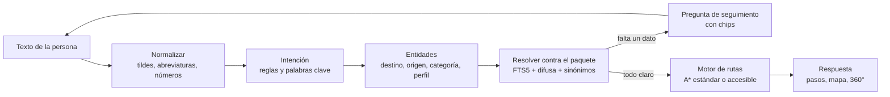
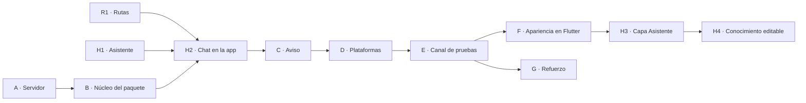

# Plan de trabajo: guía sin conexión y chatbot

> [!abstract] Lo que pidió el equipo
> «Eso funcionará **sin internet** y debe haber un **chatbot que te ayude a ir a ese lugar**.»
> Esta nota es el paso a paso para construirlo. El diseño del motor está en [[Chatbot y horarios]]. Los datos llegan con el paquete de [[Flujo de actualización (plataforma → apps)]].

> [!success] Garantía principal
> El chatbot **nunca usa la red**. Entiende la pregunta, encuentra el lugar y calcula la ruta con lo que trae el teléfono: `datos.sqlite` y la apariencia del paquete. Funciona igual en modo avión desde el primer arranque, gracias a la semilla.

---

## 1. Qué tiene que poder hacer

```text
Persona: ¿cómo llego a la biblio?
Asistente: Te llevo a la Biblioteca (Bloque 2, piso 1). ¿Desde dónde sales?
           [Desde donde estoy] [Portería principal] [Elegir en el mapa]
Persona: portería
Asistente: Ruta lista: 4 min (280 m). Hay una ruta sin escaleras de 5 min.
           1. Sigue recto 120 m por el pasillo central.
           2. Gira a la derecha en la cafetería.
           3. Entra al Bloque 2 y sube por la rampa.
           [Ver en el mapa] [Seguir en 360°] [Sin escaleras]
```

| Pregunta | Qué usa | Respuesta |
|---|---|---|
| «Llévame a la biblioteca» · «¿Cómo llego al lab de redes?» | Buscador + motor de rutas | Ruta con pasos, distancia y tiempo |
| «¿Dónde queda el aula 305?» | Buscador | Ficha: bloque, piso y un botón para ir |
| «¿Hay un baño cerca?» | Categoría + distancia sobre el grafo | Los 3 más cercanos, con ruta |
| «Llévame sin escaleras» · «voy en silla de ruedas» | Perfil accesible | Solo tramos accesibles; si no hay camino, lo dice |
| «¿Dónde es Cálculo I?» (con sesión institucional) | Horarios | Salón, hora de hoy y botón para ir |
| «¿Qué puedes hacer?» · lo que no entiende | Ayuda | Lo que sabe hacer y sugerencias; **nunca inventa** |

**Desde dónde sale**, en este orden:
1. El nodo de la foto 360° que se está viendo.
2. El último QR escaneado, si no ha caducado.
3. Lo que la persona elija.

Si no hay ninguno, la sugerencia por defecto es la portería principal.

---

## 2. Cómo está armado



| Pieza | Carpeta en `app/lib` | Depende de |
|---|---|---|
| Motor de rutas | `features/rutas/` (A*, Dijkstra como oráculo en las pruebas, pasos y tiempos) | Solo datos: lista de nodos y tramos |
| Motor del asistente | `features/asistente/dominio/` (normalizador, intenciones, entidades, resolvedor, diálogo y respuestas) | Una interfaz `FuenteGuia` con espacios, nodos, tramos y textos |
| Datos | `core/datos/` (lee `datos.sqlite` del paquete; ver [[Plan de trabajo - actualizaciones]], fase B) | El paquete |
| Pantalla del chat | `features/asistente/ui/` | Los dos motores y el mapa y el visor 360° |

> [!tip] Por qué se puede empezar ya
> Los dos motores son **Dart puro**: reciben listas y devuelven respuestas. Se construyen y se prueban con los datos de ejemplo del repositorio (`datos/ejemplo/`), sin esperar a que la app lea el paquete. Cuando esté la fase B, `FuenteGuia` pasa a leer `datos.sqlite` y nada más cambia.

---

## 3. Lo que va en el paquete (editable desde la plataforma)

| Qué | Dónde | Cuándo |
|---|---|---|
| Espacios, nodos, tramos, QR, horarios y calendario | `datos.sqlite` (ya existe) | Ya |
| Apariencia del asistente: si se ve, nombre, saludo, color y posición del botón | `configuracion_app.asistente`, con su capa en el apartado Cliente | Fase H3 |
| Conocimiento: sinónimos («biblio» = biblioteca), lugares destacados y respuestas frecuentes | `configuracion_app` (clave `asistente`) o una tabla propia del paquete | Fase H4 |

Así, mejorar el asistente **no exige** una versión nueva de la app: se edita en la plataforma, se publica y llega con el aviso de siempre.

---

## 4. Fases

| Fase | Qué se hace | Está lista cuando… |
|---|---|---|
| **R1 · Motor de rutas** | Grafo desde nodos y tramos · A* estándar (distancia) y accesible (solo tramos `accesible`) · Dijkstra como oráculo · pasos («sigue recto», «gira a la derecha», «sube la escalera») con nombres de los nodos · tiempo a 1,2 m/s (accesible a 0,8 m/s) | A* coincide con Dijkstra en grafos al azar; con escaleras, la ruta accesible las evita o dice que no hay camino |
| **H1 · Motor del asistente** | Normalizador, intenciones, entidades, resolvedor con tolerancia a 1 o 2 errores, diálogo con espacios por llenar y respuestas en español | Pasan las **pruebas doradas** (unos 30 diálogos: errores de escritura, ambigüedad, sin escaleras, lugar que no existe) |
| **H2 · Chat en la app** | Burbuja flotante y panel de chat (en horizontal, a un lado), chips, «Ver en el mapa» con la ruta dibujada y «Seguir en 360°» resaltando las flechas del camino | De punta a punta en modo avión, en Android, Windows y web |
| **H3 · Capa «Asistente» en el apartado Cliente** | Nombre, saludo, color y posición del botón; se ve en la vista previa | La app muestra el asistente como en la vista previa |
| **H4 · Conocimiento editable** | Sinónimos, lugares destacados y respuestas frecuentes en la plataforma, y un probador con las mismas pruebas doradas (`docs/datos/asistente-pruebas.json`) | Un sinónimo nuevo publicado hace que la app entienda una frase que antes no |

> [!success] R1 hecha (5 de noviembre de 2026)
> - **Código:** `app/lib/features/rutas/` (`grafo.dart`, `buscador.dart`, `pasos.dart`), en Dart puro y sin red.
> - **Pruebas:** 11 en `app/test/rutas/rutas_test.dart`, con los datos de ejemplo y 2.000 comparaciones contra Dijkstra en grafos al azar (incluidos los casos sin camino). `flutter analyze` sin problemas; las 75 pruebas de la app pasan.
> - **Decisiones:** un tramo nunca cuesta menos que la línea recta (así A* da la ruta óptima aunque haya una mala medida) y los giros se avisan desde 35°.

> [!success] H1 hecha (5 de noviembre de 2026)
> - **Código:** `app/lib/features/asistente/`. Lo que hace cada archivo:
>   - `texto.dart`: normalizar y tolerar errores.
>   - `conocimiento.dart`: lugares, categorías, sinónimos y artículos del español.
>   - `resolvedor.dart`: qué lugar quiso decir.
>   - `analisis.dart`: la intención.
>   - `motor.dart`: la conversación.
>   - `respuesta.dart`: textos y botones.
> - **Lo que hace:**
>   - Pregunta desde dónde sales, o usa el nodo del 360° o del QR, y elige entre varios lugares parecidos.
>   - Calcula la ruta sin escaleras (y si no hay, lo dice y ofrece la otra) y el baño más cercano.
>   - Dice dónde queda un lugar. Con lo que no sabe, explica lo que sí sabe hacer: **nunca inventa** y **nunca usa la red**.
> - **Pruebas:** 23 diálogos dorados en `app/test/asistente/asistente_test.dart`. La app entera: 98 pruebas y `flutter analyze` sin problemas.

**Pruebas que no pueden faltar:** «biblio», «bilbioteca» y «la biblioteca porfa» llevan al mismo lugar · «¿dónde es el 305?» encuentra B3-305 · «baño» encuentra «servicios» · con dos coincidencias pregunta cuál · un lugar sin ruta accesible lo dice claro · una pregunta fuera de tema responde con ayuda, **sin inventar** · nada de esto usa la red.

---

## 5. Orden con el otro plan



- **R1 y H1** se hacen al tiempo que **A y B**, porque no dependen de ellas.
- **H2** junta todo: necesita el paquete (B) y los dos motores.
- Lo visual del asistente (**H3 y H4**) va después de la fase F, cuando la app ya dibuje la apariencia que manda la plataforma.

---

## 6. Propuesta para el tablero (todavía no creadas en GitHub)

| ID | Título | Fase |
|---|---|---|
| TEC-20 | Motor de rutas: A* estándar y accesible, con Dijkstra como oráculo | R1 |
| TEC-21 | Motor del asistente sin conexión, con pruebas doradas | H1 |
| HU-32 | Como visitante, quiero preguntarle al asistente cómo llegar a un lugar y que me guíe, sin internet | H2 |
| HU-33 | Como administrador, quiero enseñarle sinónimos y respuestas al asistente desde la plataforma | H4 |

Lo de rutas ya está en el tablero y R1 y H2 lo cumplen:
- **HU-01** buscar un aula u oficina · **HU-03** elegir el origen de una lista · **HU-04** camino más corto a pie.
- **HU-05** ver la ruta sobre el plano · **HU-06** origen por QR · **HU-07** ruta sin escaleras ni desniveles.
- **HU-08** distancia y tiempo · **HU-11** ruta piso por piso · **HU-12** saltar del 360° a la ruta.

Las propuestas de arriba solo agregan lo del asistente.

Relacionado: [[Chatbot y horarios]] · [[Plan de trabajo - actualizaciones]] · [[Flujo de actualización (plataforma → apps)]] · [[Cliente Flutter]] · [[Hoja de ruta]]

Volver a [[00 Sistema - Índice]] · [[00 UniPaz360 - Índice]]
