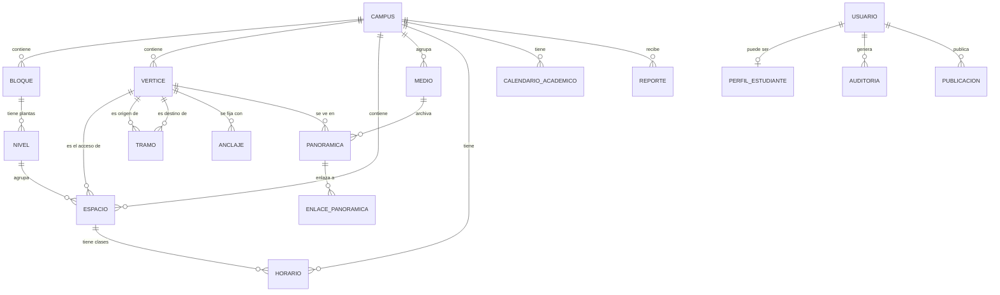

# Modelo central de datos (TEC-04 v2)

La **base central** vive en Neon (PostgreSQL 18 + PostGIS 3.6) y es la **fuente de la
verdad** del campus: el panel de administración la edita y el pipeline (TEC-05) la
empaqueta para la app. La app **no** la consulta directamente: descarga un paquete.

- Esquema ejecutable: [`db/migraciones/0001_esquema_inicial.sql`](../../db/migraciones/0001_esquema_inicial.sql)
- Cómo se aplica: [`db/README.md`](../../db/README.md)
- El modelo **local** (SQLite que viaja en la app) está en [modelo-er.md](modelo-er.md).

## Relaciones

## Diccionario de datos

| Entidad | Para qué sirve | Historia / tarea |
|---|---|---|
| **CAMPUS** | Sede (hoy: Santa Lucía). Centro y zoom del mapa. Permite varios campus a futuro. | TEC-04 |
| **BLOQUE** | Edificio y su huella (`POLYGON`). | HU-02, TEC-10 |
| **NIVEL** | Piso de un bloque, con su plano 2D georreferenciado. | HU-02, TEC-10 |
| **ESPACIO** | Aula, oficina, laboratorio… buscable. Se llega por su vértice de acceso. | HU-01, HU-02 |
| **VERTICE** | Punto de la red peatonal (puerta, cruce, escalera, rampa…). | HU-03, HU-04 |
| **TRAMO** | Camino entre dos vértices; sus atributos deciden la accesibilidad. | HU-04, HU-07, HU-08 |
| **ANCLAJE** | Placa QR: su URI se traduce al vértice de origen. | HU-06 |
| **MEDIO** | Archivo en R2 (foto, panorama, ortofoto, video, modelo, plano) con hash y LODs. | TEC-03, TEC-05 |
| **PANORAMICA** | Foto 360° en un vértice, con rumbo inicial. | HU-10 |
| **ENLACE_PANORAMICA** | Saltos entre panorámicas (muchos a muchos). | HU-10, HU-12 |
| **HORARIO** | Franja de clase de un espacio (día, horas, materia, programa, grupo). | HU-11, chatbot |
| **CALENDARIO_ACADEMICO** | Festivos, inicio/fin de semestre, exámenes. "¿Hay clase el 20 de julio?". | chatbot |
| **USUARIO** | Cuentas del panel (superadmin/editor/lector) y de la app (estudiante). | F3 |
| **PERFIL_ESTUDIANTE** | Programa, semestre y grupo de un estudiante, para filtrar sus horarios. | HU-11 |
| **AUDITORIA** | Bitácora: quién cambió qué, cuándo y con qué valores (antes/después). | F3 |
| **PUBLICACION** | Versión del paquete generada y publicada. | TEC-05, TEC-07 |
| **REPORTE** | Error enviado desde la app, con o sin conexión. | HU-13 |

## Reglas que verifica la base

- `ESPACIO.codigo` es único **por campus**.
- Un tramo no puede unir un vértice consigo mismo (`origen_id <> destino_id`).
- `accesible = true` exige `escaleras = false` **y** `verificado = true`.
- En un horario, `hora_inicio < hora_fin`, y `dia` va de 1 (lunes) a 7 (domingo).
- `actualizado_en` se mantiene solo, con un disparador en cada `UPDATE`
  (usa `clock_timestamp()`, así que cambia incluso dentro de una transacción).
- Las geometrías van en **SRID 4326** con índice GIST; `VERTICE` guarda además
  `lat`/`lon` planos.

## Acceso según el tipo de usuario (cliente)

| Función | Invitado | Correo institucional |
|---|:--:|:--:|
| Mapa 2D, búsqueda, rutas, 360°, tour con dron | ✅ | ✅ |
| Reportes y sugerencias | ✅ | ✅ |
| Chatbot (rutas, ubicaciones, cómo llegar) | ✅ | ✅ |
| **Horarios de salones y calendario académico** | ❌ | ✅ |
| Favoritos y "mi horario" | ❌ | ✅ |

> El paquete de datos **no** incluye horarios personales. Éstos se consultan con
> sesión iniciada (API del panel) y se cachean para uso sin conexión del propio
> usuario. El resto del contenido funciona sin conexión para todos.

## Decisiones abiertas

- `servicios`: hoy es un `TEXT[]`; si crece, se normaliza en una tabla `SERVICIO`.
- Multi-campus: las tablas ya llevan `campus_id`; falta decidir si la app gestiona
  varios paquetes a la vez.
- `PERFIL_ESTUDIANTE`: confirma si se llena desde el directorio institucional o lo
  escribe el propio estudiante.
