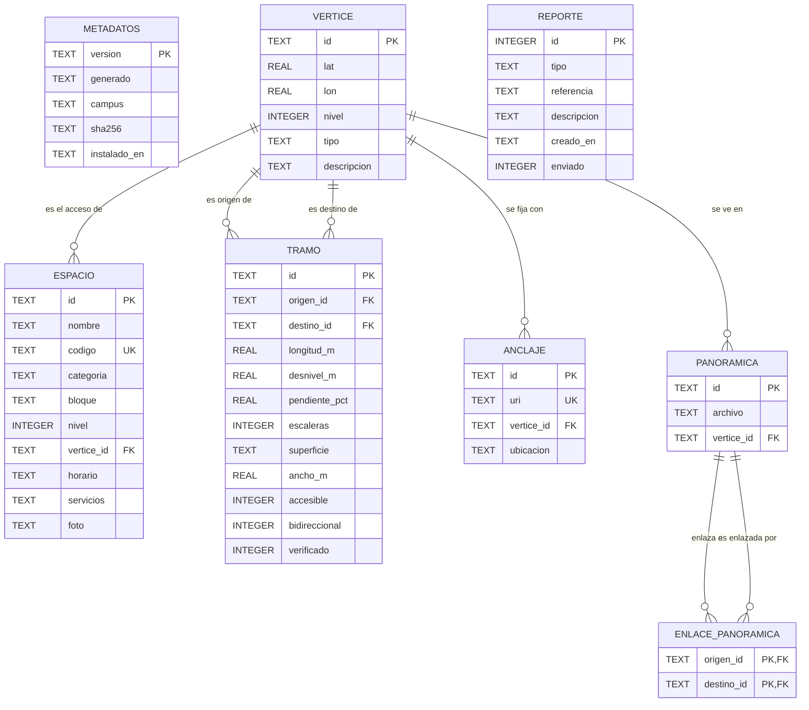

# Modelo entidad-relación de la base de datos local (TEC-04)

**Borrador para revisar en equipo.** La base vive en el teléfono (SQLite) y se llena con el paquete de datos del campus; el formato del paquete está en [formato-paquete.md](formato-paquete.md). El script SQL equivalente está en [esquema.sql](esquema.sql).

## Diccionario de datos

| Entidad | Para qué sirve | Historias que la usan |
|---|---|---|
| **METADATOS** | Versión, fecha y hash del paquete instalado. Permite saber si hay una actualización. | HU-09, TEC-07 |
| **VERTICE** | Punto de la red peatonal: puerta, cruce, escalera, rampa, acceso o referencia. | HU-03, HU-04, HU-05 |
| **ESPACIO** | Aula, oficina, laboratorio u otro lugar que se busca. Se llega a él por su vértice de acceso. | HU-01, HU-02 |
| **TRAMO** | Trozo de camino entre dos vértices, con los atributos que deciden si es accesible. | HU-04, HU-07, HU-08 |
| **ANCLAJE** | Placa QR: su URI se traduce al vértice de origen. | HU-06 |
| **PANORAMICA** | Foto 360° tomada en un vértice. | HU-10 |
| **ENLACE_PANORAMICA** | Relación muchos a muchos entre panorámicas, para saltar de una a otra. | HU-10, HU-12 |
| **REPORTE** | Reporte de error escrito sin conexión. Se guarda y se envía a la API cuando hay red (`enviado = 1`). | HU-13 |

## Reglas que verifica la base
- `ESPACIO.codigo` y `ANCLAJE.uri` son únicos.
- Un tramo no puede unir un vértice consigo mismo (`origen_id <> destino_id`).
- `accesible = 1` exige `escaleras = 0` y `verificado = 1`. Se verifica con una restricción CHECK y también en el script de empaquetado (TEC-05).
- Los campos booleanos son `INTEGER` con valor 0 o 1, porque SQLite no tiene tipo booleano.
- Hay índices por `TRAMO(origen_id)`, `TRAMO(destino_id)` y `ESPACIO(nombre)` para que la búsqueda y la carga del grafo sean rápidas.

## Decisiones abiertas para el equipo
- Guardar `servicios` como texto separado por comas o crear una tabla `SERVICIO` (normalizar).
- Si `PANORAMICA` debe guardar la orientación inicial de la foto (rumbo) para que el visor 360° abra mirando hacia el camino.
