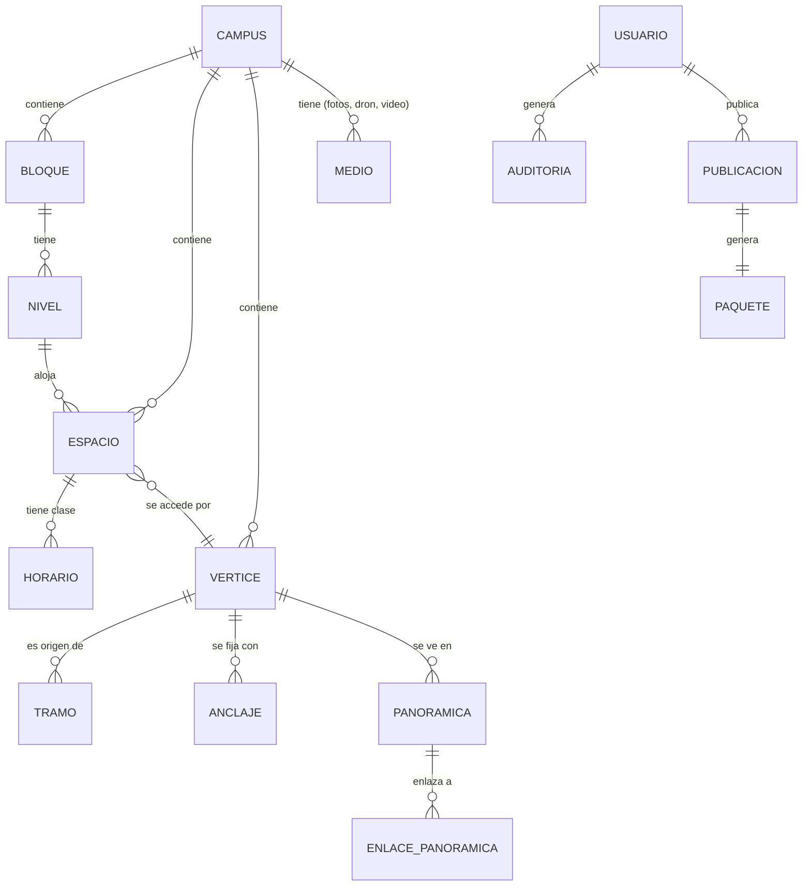

# 3 · Modelo de datos y publicación (el corazón del sistema)

> Esta parte es el equivalente al «pipeline» de Google Maps: cómo se guardan los datos, cómo se empaquetan y cómo llegan al teléfono sin conexión.

## 3.1 Las dos bases de datos

| | Base central (Neon/PostgreSQL) | Base local (SQLite en el dispositivo) |
|---|---|---|
| Rol | Fuente de la verdad; la editan los administradores | Réplica de solo lectura que usa la app |
| Quién la toca | Panel (a través de la API) | Solo el sincronizador de la app |
| Cuándo | Siempre en línea | Siempre offline |
| Esquema | Completo (con usuarios, auditoría, borradores) | Solo lo que la app necesita (`docs/datos/esquema.sql` evoluciona aquí) |

El paquete de datos **es** una exportación de la base central hacia el esquema local. Por eso el script de empaquetado (TEC-05) se convierte en el componente más importante del pipeline: **valida en el servidor lo mismo que la app exige en el dispositivo**.

## 3.2 Modelo entidad-relación central (evolución de TEC-04)

Se extiende el modelo local actual con lo que exige el sistema completo (negrita = nuevo). Todo con `campus_id` para escalar a otras sedes.



### Entidades principales (resumen)

| Entidad | Campos clave | Novedad |
|---|---|---|
| **CAMPUS** | id, nombre, centro (lat/lon), zoom por defecto | agrupa todo; permite múltiples sedes |
| **BLOQUE** | id, nombre, `geometria` (polígono), altura_m | footprint para dibujar en el mapa 2D y 3D |
| **NIVEL** | id, bloque, número (0, 1…), elevación_m, `plano_url` | plano de piso (imagen georreferenciada) o geometría |
| ESPACIO | como hoy + **nivel_id**, **poligono** (contorno del salón) | se puede dibujar el salón, no solo el punto |
| VERTICE | como hoy + `geometria` (punto) | PostGIS calcula distancias reales |
| TRAMO | como hoy + **`geometria` (línea)** + longitud calculada | la ruta se dibuja con la forma real del pasillo, no una línea recta |
| PANORAMICA | como hoy + **orientación inicial (rumbo)**, **nivel de detalle (LOD)**, enlaces | estilo Street View |
| **MEDIO** | id, tipo (foto/video/ortophoto/modelo), archivo, LODs, licencia | fotos de espacios, video de dron, ortomosaico |
| **HORARIO** | espacio, día, inicio, fin, materia, programa, semestre, grupo, docente | alimenta la ficha del salón y el chatbot |
| **USUARIO** | id, correo institucional, nombre, rol, activo | panel |
| **AUDITORIA** | usuario, acción, entidad, entidad_id, antes/después (jsonb), IP, agente, fecha | trazabilidad |
| **PUBLICACION** | id, versión, autor, fecha, notas, estado (borrador/publicado/revertido) | historial de «enviar a producción» |
| REPORTE | como hoy + estado (nuevo/en proceso/resuelto) | bandeja del panel |

### Reglas que el pipeline valida (antes de publicar)

1. **Grafo conexo:** BFS desde cualquier vértice; si hay islas, se bloquea la publicación.
2. **Todo espacio tiene acceso:** cada `ESPACIO.vertice_id` existe.
3. **Accesibilidad coherente:** `accesible = 1` ⇒ sin escaleras y verificado en campo (ya existe en el CHECK; se valida también en servidor).
4. **Ruta accesible existe:** para cada bloque con espacios públicos, al menos una ruta sin escaleras desde la portería principal. Si no, **aviso** (no bloqueo) en el informe de publicación.
5. **Medios completos:** fotos y panorámicas referenciadas existen en R2 con hash.
6. **QR estables:** los `uri` de anclajes publicados no cambian ni se reutilizan (¡están impresos en placas físicas!).
7. **Horarios sin choques:** mismo espacio, mismo día, franjas que no se solapan (advertencia).

## 3.3 Paquete offline v2 (decisión D4)

**Cambio recomendado respecto al borrador actual:** en vez de JSON que la app convierte a SQLite, el servidor **construye directamente el archivo SQLite**. La app solo lo descarga, verifica y cambia. Beneficios: menos código en la app, búsqueda FTS5 precalculada, mismos índices y CHECK en desarrollo y producción, versionado de esquema con `PRAGMA user_version`.

```
unipaz360-2026.11.1/            (un directorio, espejo en R2)
├── manifest.json               ← lista de archivos, tamaños, SHA-256, versión de esquema
├── datos.sqlite               ← base lista (espacios, vértices, tramos, horarios, FTS5)
├── medios/
│   ├── espacios/B1-101.jpg     ← fotos de fichas (con miniatura incluida)
│   ├── 360/p01_n0.jpg          ← LOD 0 (rápida)
│   ├── 360/p01_n1.jpg          ← LOD 1 (alta)
│   └── dron/ortophoto_z14.mbtiles  ← ortomosaico por niveles de zoom
└── version.json                ← { "version": "2026.11.1", "manifiesto": "...", "sha256": "..." }
```

**Manifest (ejemplo):**
```json
{
  "version": "2026.11.1",
  "generado": "2026-11-05T18:00:00-05:00",
  "campus": "santa-lucia",
  "esquema_sqlite": 3,
  "archivos": [
    { "ruta": "datos.sqlite", "bytes": 1835008, "sha256": "…" },
    { "ruta": "medios/360/p01_n0.jpg", "bytes": 921600, "sha256": "…" }
  ],
  "totales": { "bytes": 268435456, "archivos": 312 }
}
```

### Cómo vive el paquete en el teléfono

```
almacenamiento/
├── paquete-actual/          ← versión activa (datos.sqlite + medios)
├── paquete-anterior/        ← respaldo para revertir si la nueva falla
└── descargas/               ← descarga en curso (se borra al fallar)
```
- Cambio de versión **atómico**: se descarga completo, se verifica el hash, se renombran carpetas. Si algo falla, la app sigue con la anterior.
- **Aviso de actualización (decidido):** al abrir la app, si hay una versión nueva se muestra una notificación; la persona decide entre **Actualizar ahora** o **Más tarde**. «Más tarde» vuelve a preguntar en la próxima apertura. La app **nunca** se actualiza sola ni en silencio.
- Espacio ocupado: se muestra en Ajustes («Datos del campus: 256 MB · actualizado hoy»).
- **Descarga por zonas (D5):** base (plano + datos + 360 en LOD 0) ~80 MB; alta resolución de 360° por bloques, bajo demanda o por Wi-Fi.

## 3.4 El botón «Enviar a producción»

```
[Panel] Publicar (versión 2026.11.2, notas)
   │  crea fila en PUBLICACION estado=borrador
   ▼
[GitHub Action publicar.yml]
   1. Exporta de Neon (rama main) a datos temporales
   2. Valida (las 7 reglas de §3.2) → si falla: PUBLICACION=fallida + informe en el panel
   3. Construye datos.sqlite (esquema vN + FTS5)
   4. Genera LODs de fotos nuevas, verifica hashes
   5. Sube a R2:  paquetes/2026.11.2/**  (inmutable)
   6. Actualiza version.json (puntero a la última) y purga caché del CDN
   7. PUBLICACION=publicada
   ▼
[App] al abrir con red: consulta version.json → si hay versión nueva muestra el aviso
        [Actualizar ahora] [Más tarde] → «ahora»: descarga → verifica → cambia;
        «más tarde»: se vuelve a preguntar en la próxima apertura (nunca se actualiza solo)
```

**Reversión:** cambiar el puntero `version.json` a la versión anterior (registrada en `PUBLICACION`). Sin reempaquetar, en segundos.

**Borradores:** el panel trabaja sobre tablas `*_borrador` o un esquema `borrador` en Postgres; solo se publica lo aprobado. Así los cambios a medias nunca llegan a los teléfonos.

## 3.5 Compatibilidad de esquemas

| Caso | Regla |
|---|---|
| App vieja + paquete nuevo | `manifest.esquema_sqlite` mayor que el soportado ⇒ la app avisa «actualiza la aplicación» y sigue con su paquete actual |
| App nueva + paquete viejo | Compatible: el sincronizador soporta los últimos N esquemas |
| Campos nuevos | Migraciones aditivas en `scripts/`; nunca borrar campos en el mismo ciclo |
| QR impresos | `ANCLAJE.uri` inmutable **para siempre**; un QR retirado se marca inactivo, no se reutiliza |

## 3.6 Reportes de usuarios (HU-13)

```
App (offline) → reporte en SQLite local (enviado=0)
   → al haber red, POST /api/reportes (foto opcional) → Neon
   → bandeja en el panel: estado (nuevo/en proceso/resuelto) + comentarios
   → al resolver: se corrige el dato → nueva publicación
```
El panel muestra cada reporte **sobre el mapa** (clic para ver el punto). Los reportes con foto del usuario valen oro para validar el levantamiento.
