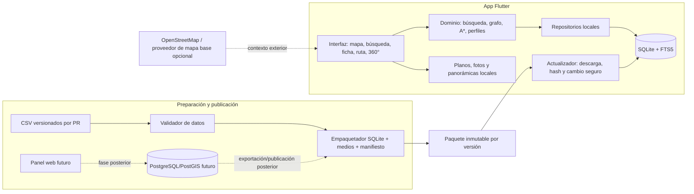

# 8 · Análisis funcional de Google Maps y arquitectura cartográfica

> **Propósito:** aprender de las funciones que el usuario ve en Google Maps y Street View, y traducirlas a una arquitectura propia, libre y viable para UniPaz360. Esto no pretende descubrir ni copiar código, datos privados o servicios internos de Google.
>
> **Estado:** propuesta técnica basada en el repositorio y documentación pública consultada el 20 de octubre de 2026. Las decisiones de producto deben validarse con el equipo antes de comprometer una implementación grande.

## 8.1 Qué significa «ingeniería inversa» aquí

La implementación interna de Google Maps es propietaria. No es posible deducir de forma fiable sus algoritmos, infraestructura, modelos de datos ni lógica de negocio observando únicamente la app. Lo que sí podemos estudiar de forma legítima y útil es su **comportamiento observable**: qué información presenta, cómo responde a gestos y búsquedas, qué capas combina, cómo guía al usuario y cómo maneja distintos niveles de detalle.

Por eso, el análisis se organiza como una descomposición funcional:

1. Registrar una interacción visible de Maps.
2. Identificar qué información y estado necesita esa interacción.
3. Definir el resultado que UniPaz360 necesita para su campus.
4. Elegir una pieza abierta o propia para producir ese resultado.
5. Especificar cómo funciona sin conexión y cómo se comprueba.

No se deben copiar la interfaz exacta, marcas, imágenes, teselas ni datos de Google. La referencia sirve para entender patrones de uso, no para reutilizar sus activos.

## 8.2 Descomposición por capacidades

| Capacidad visible | Qué requiere el sistema | Equivalente para UniPaz360 | Estado en el repositorio |
|---|---|---|---|
| Mapa que se desplaza, acerca y rota | Motor de renderizado, estilo, fuentes de datos y cámara | MapLibre para capas cartográficas; plano local del campus como fuente prioritaria | El visor del dron ya permite mover/zoom sobre una imagen local y ahora ofrece modo aéreo y plano B/N esquemático |
| Capas y marcadores | Entidades geográficas y reglas de dibujo | GeoJSON o entidades del paquete para bloques, espacios, vértices y rutas | Datos de ejemplo y puntos del dron son simulados/estáticos |
| Buscar lugares | Índice textual, normalización, ranking y detalles | SQLite FTS5 para espacios y materias, con búsqueda sin red | FTS5 se genera en el paquete, pero la app aún no lo consume |
| Calcular indicaciones | Grafo transitable, restricciones, costo y presentación de pasos | Grafo propio del campus; A* para distancia/tiempo y perfil accesible | Hay trazados fijos de demostración sobre la foto; no existe cálculo sobre el grafo real |
| Seleccionar origen | Ubicación del usuario o punto elegido | Elegir referencia o escanear QR; no se presupone GPS interior | El inicio por QR y selector de origen siguen pendientes |
| Ver interiores/planta | Edificio, nivel, geometría y conectores verticales | Plano por nivel enlazado a un grafo continuo entre exteriores e interiores | El modelo contempla niveles; falta editor y datos reales del piloto |
| Vista 360° | Imagen equirectangular, cámara virtual, orientación y enlaces | Visor local y enlaces entre panorámicas del paquete | Motor y pantalla de muestra existen; carga una imagen de ejemplo |
| Actualizar mapas | Versiones, transferencia, integridad, instalación y reversión | Paquete SQLite versionado con manifiesto y hashes | El pipeline local existe; falta integración del paquete/sincronizador en la app |
| Editar datos | Herramientas de autoría, validación y publicación | Primero CSV versionados por PR; panel de administración en fase posterior | Scripts y migraciones existen; panel aún no tiene código |

## 8.9 Referencia visual: Tour Virtual de La Sabana

Se revisó la experiencia interactiva de [unisabana.edu.co/tour-virtual](https://www.unisabana.edu.co/tour-virtual/). La primera vista combina una escena aérea panorámica con marcadores seleccionables, una vista general del campus en una esquina, acceso al mapa, un menú lateral por secciones y controles para iniciar el recorrido. Las escenas 360° permiten explorar el lugar y saltar a puntos enlazados.

La idea transferible es el **modelo de navegación**: empezar con una vista que ubica al visitante, ofrecer hitos claros, mostrar un mapa de contexto y permitir abrir el lugar elegido. Para UniPaz360 se adapta así:

1. La foto local del dron es el modo aéreo inicial; queda disponible en el paquete y no necesita conexión.
2. El usuario toca un marcador, ve su ficha y puede abrir el recorrido 360° asociado cuando exista.
3. Un selector alterna entre la foto y un plano monocromático trazado para el campus.
4. «Cómo llegar» resalta el recorrido desde la portería hasta el marcador seleccionado.
5. Los paneles laterales y la lista de lugares explican los hitos sin tapar el mapa.

La página de La Sabana es un **tour panorámico**, no evidencia de un motor de rutas peatonales. Los trazados iniciales de UniPaz360 se dibujan como demostración a partir de lo que parece transitable en la foto del dron y se etiquetan como preliminares. Antes de usarlos para guiar personas, el equipo debe recorrer y registrar los caminos, conexiones, cruces, pendientes y barreras; luego el motor calculará la ruta desde ese grafo.

La vista aérea y el plano ilustrado usan el mismo sistema de coordenadas normalizadas que los marcadores, así los hitos siguen en su lugar al cambiar de modo. El plano ilustrado es una representación propia aproximada, no un plano topográfico ni un levantamiento de accesibilidad.

Google documenta estas capacidades como productos distintos —mapas, lugares, rutas, imágenes Street View y otros servicios—, no como una única «API mágica». Esa separación es una buena guía para los límites de nuestros módulos.

## 8.3 Pila recomendada para este producto

### Motor de mapa: MapLibre

MapLibre es el **renderizador**: dibuja fuentes raster o vectoriales siguiendo un estilo. No trae por sí mismo la cartografía, los lugares, un geocodificador, un motor de rutas ni un proveedor de teselas.

Para el cliente Flutter, `maplibre_gl` es una opción razonable para el objetivo Android y contempla Android, iOS y web. La ficha actual indica soporte de regiones offline para Android/iOS, pero no web ni escritorio. El soporte de Flutter es una envoltura de MapLibre Native en móvil y MapLibre GL JS en web, así que no se debe prometer paridad de capacidades entre plataformas.

**Recomendación de alcance:** asegurar primero Android offline. Mantener web como prototipo/visor conectado, y no prometer mapas offline en navegador o Windows hasta elegir y verificar un motor que cubra esos destinos. El motor actual del visor 360 puede seguir siendo propio: MapLibre no reemplaza ese componente.

### Datos geográficos: fuentes propias + OpenStreetMap cuando aporte valor

- El plano del campus, los edificios, niveles, espacios, pasillos, QR y accesibilidad son datos de UniPaz360. Se almacenan y distribuyen en el paquete del campus; no deben depender de que un proveedor mundial conozca el interior de UNIPAZ.
- OpenStreetMap puede servir de contexto exterior (calles y entorno) o como referencia para mejorar datos, siempre con la atribución y licencia correspondientes.
- Para mapa base fuera del campus, elegir un proveedor compatible con MapLibre o alojar teselas propias. Revisar por separado precio, licencia, límites, caché y permiso de uso offline.
- No usar `tile.openstreetmap.org` como mecanismo de descarga offline: su política prohíbe descargas masivas/prefetch y no ofrece SLA. El hecho de que los datos OSM sean abiertos no convierte sus servidores comunitarios en un servicio gratuito de teselas para empaquetar.
- En el área del campus, estudiar un plano local georreferenciado o una tesela/imagen de campus empaquetada. Para una sola sede pequeña, mantener los elementos vectoriales del campus dentro del paquete resulta más simple que desplegar infraestructura mundial de mapas.

### Búsqueda y navegación: propias y offline

- **Buscar** en la base SQLite del paquete. Normalizar tildes y mayúsculas; ordenar código exacto por encima de nombre y coincidencias parciales.
- **Enrutar** con el grafo peatonal levantado. Cada tramo guarda distancia, dirección, nivel, escaleras, pendiente, ancho y verificación de campo.
- **Accesibilidad** debe ser un perfil de costo y restricciones visible. Primero excluir tramos no accesibles; luego minimizar distancia o tiempo entre las rutas admisibles. No inferir que una ruta es accesible solo por su longitud.
- **Instrucciones** derivan de nodos semánticos (entrada, cruce, escalera, rampa, ascensor, referencia), no solo de una polilínea dibujada.
- El GPS se ofrece únicamente como ayuda de contexto exterior. Para interiores el origen se selecciona o se fija con QR; no se presenta como seguimiento continuo.

## 8.4 Arquitectura lógica propuesta

La app debe poder responder búsquedas, fichas y rutas usando solo SQLite y los medios locales. La conexión se usa para revisar/obtener una versión nueva o para cargar un mapa base exterior opcional. Una interrupción de red no invalida el paquete instalado.

## 8.5 Límites de los componentes

| Módulo | Responsabilidad | No debe hacer |
|---|---|---|
| `mapa` | Dibujar fondo, geometría, marcadores y ruta; cámara y gestos | Decidir cuál es la ruta óptima |
| `busqueda` | Consultar FTS5, normalizar y clasificar resultados | Consultar internet para hallar espacios del campus |
| `rutas` | Resolver camino, perfil, costo y pasos usando el grafo | Leer widgets, API de Google o estado de presentación |
| `datos` | Cargar paquete, exponer repositorios y controlar esquema | Mezclar reglas de interfaz con SQL |
| `publicacion` | Validar datos, empaquetar, generar hashes y versiones | Saltarse errores de validación en producción |
| `360` | Proyectar panorama, controles de cámara y enlaces de escena | Ser la fuente de datos de espacios o rutas |
| `panel` (futuro) | Editar, previsualizar, auditar y publicar datos centrales | Ser dependencia online de la navegación del usuario |

En Flutter, la separación debe reflejarse en contratos de repositorio y servicios de dominio. La interfaz no debe importar el simulador directamente; el simulador es un adaptador de demostración que debe poder sustituirse por un repositorio SQLite sin reescribir pantallas.

## 8.6 Contrato mínimo del paquete offline

El formato ya documenta un paquete `datos.sqlite`, `manifest.json`, `version.json` y `medios/`. Se recomienda conservarlo y hacer explícitos estos requisitos antes de conectarlo a la app:

1. `version.json` identifica campus, versión y manifiesto; el manifiesto lista cada archivo, tamaño y SHA-256.
2. El instalador descarga a un área temporal, verifica hashes y versión del esquema, comprueba que SQLite abre y solo entonces activa el paquete nuevo.
3. La base actualmente activa no se reemplaza parcialmente. Ante fallo, se conserva la versión funcional anterior.
4. Los medios se referencian con rutas relativas controladas por el paquete; no se permite que un CSV apunte a rutas arbitrarias del dispositivo.
5. Cada publicación es inmutable. Volver atrás significa cambiar el puntero de versión y reinstalar un paquete anterior, no editar el artefacto publicado.
6. Las reglas de compatibilidad entre `esquema_version` y la app se documentan y se verifican antes de activar una versión.

## 8.7 Plan de trabajo por etapas

| Etapa | Entrega revisable | Criterio para avanzar |
|---|---|---|
| 0. Alinear el producto | Inventario de funciones, plataformas objetivo y decisiones de mapas | El equipo distingue mapa base, plano del campus, búsqueda, rutas y 360° |
| 1. Datos fiables | Levantamiento real del bloque piloto, georreferenciado y verificado | Validador sin errores y conectividad probada; accesibilidad revisada en campo |
| 2. Dominio offline | Repositorio SQLite en Flutter, búsqueda y grafo | La app lee el paquete de ejemplo; pruebas de búsqueda/ruta usan el mismo contrato |
| 3. Mapa de campus | Planta exterior y nivel, puntos y ruta dibujados | Funciona en Android en modo avión sin solicitar teselas del servidor comunitario |
| 4. Instalación de versiones | Descarga opcional, integridad, activación atómica y rollback | Un paquete corrupto o incompatible no rompe la versión activa |
| 5. Experiencia ampliada | QR físico, 360° enlazado, accesibilidad y pruebas con usuarios | Cumple criterios de aceptación y se verifica en dispositivo real |
| 6. Operación desde panel | CRUD, auditoría, medios y publicación desde web | Se inicia cuando el flujo CSV→paquete y la app ya son estables |

La prioridad inmediata derivada de la revisión no es contratar una API cartográfica. Es completar y validar el dato del piloto y conectar la app al paquete local. El renderizador puede cambiarse sin rehacer búsqueda ni rutas si las capas conservan contratos claros.

## 8.8 Decisiones recomendadas y pendientes

| Decisión | Recomendación | Confirmación pendiente |
|---|---|---|
| Cartografía interior | Grafo y planos propios incluidos en el paquete | Método de captura, autoría y licencia del plano del campus |
| Motor Flutter | Evaluar `maplibre_gl` para Android y web; asumir offline nativo solo en Android/iOS | Probar integración real con la versión de Flutter fijada y evaluar Windows/web offline por separado |
| Mapa exterior | Capa opcional OSM mediante proveedor compatible o teselas propias | Elegir proveedor/licencia y política de caché; no usar el servidor público OSM para descargas offline |
| Rutas | Motor propio sobre el grafo peatonal; A* y Dijkstra de referencia | Definir tiempos por tipo de tramo y reglas formales de accesibilidad |
| Base central y panel | Mantener Neon/PostGIS y panel como fases posteriores | No bloquear el MVP móvil en esas dependencias |
| Plataformas | Priorizar Android físico y modo avión según DoD del curso | Aclarar si web y Windows son entregables obligatorios o solo demos |

## 8.9 Editor local del mapa de dron

El prototipo Flutter permite agregar puntos tocando la foto, asignarles nombre, categoría, zona y descripción, moverlos o editarlos y eliminarlos. La misma coordenada normalizada se usa en la vista aérea y en el plano esquemático blanco y negro. Los cambios se conservan en el almacenamiento local del dispositivo; no se escriben en Neon ni en R2.

Los marcadores iniciales y las líneas de ruta que se dedujeron visualmente de la foto son borradores. La app muestra el aviso de validación en campo para esas rutas. Un punto nuevo no recibe una ruta automática: para habilitar indicaciones reales debe vincularse al grafo peatonal verificado, con cruces y restricciones de accesibilidad. El editor central con historial, revisión y publicación sigue siendo una etapa posterior.

## Fuentes técnicas

- [Google Maps Platform: capacidades y productos por plataforma](https://developers.google.com/maps/apis-by-platform)
- [MapLibre GL JS: documentación e introducción](https://maplibre.org/maplibre-gl-js/docs/)
- [Especificación de fuentes de MapLibre](https://maplibre.org/maplibre-style-spec/sources/)
- [Flutter MapLibre GL: plataformas y soporte de funciones](https://pub.dev/packages/maplibre_gl)
- [Política oficial de teselas de OpenStreetMap](https://operations.osmfoundation.org/policies/tiles/)
- [Mapeo interior simple de OpenStreetMap](https://wiki.openstreetmap.org/wiki/Simple_Indoor_Tagging)
- [Recomendaciones OSM para navegación peatonal, incluida la interior](https://wiki.openstreetmap.org/wiki/Guidelines_for_pedestrian_navigation)
- [Tour Virtual de la Universidad de La Sabana (referencia de experiencia)](https://www.unisabana.edu.co/tour-virtual/)
