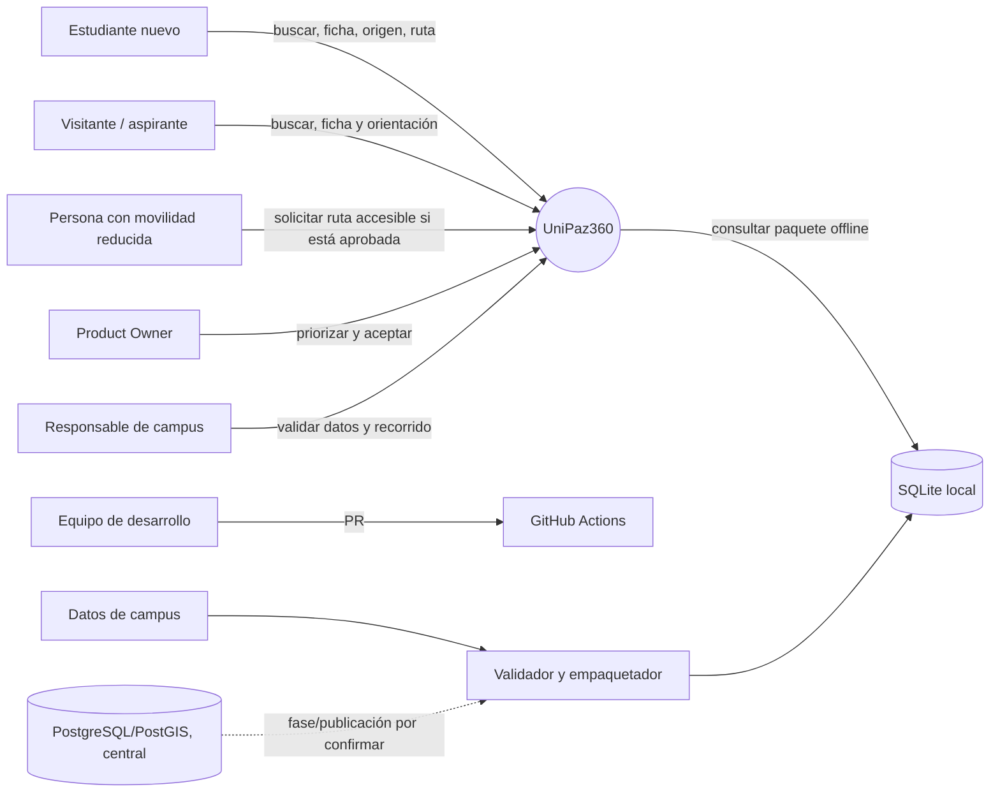
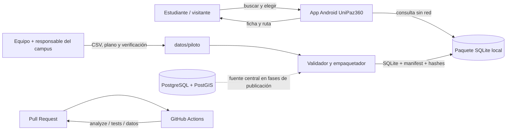
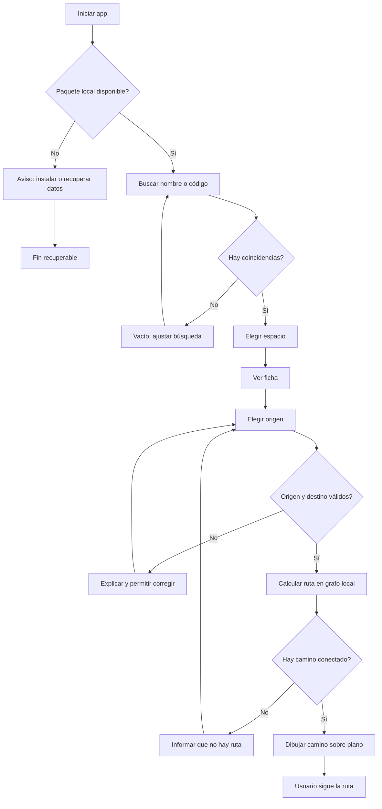
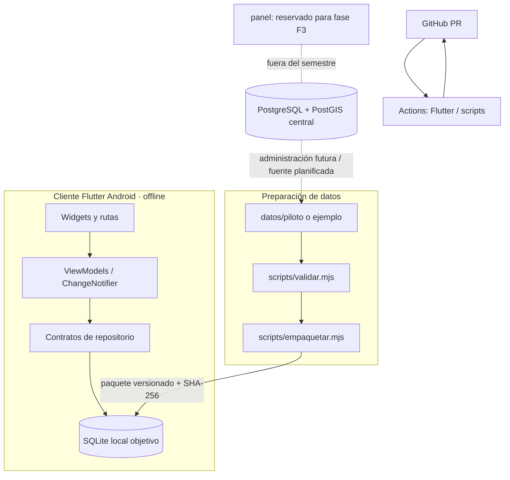
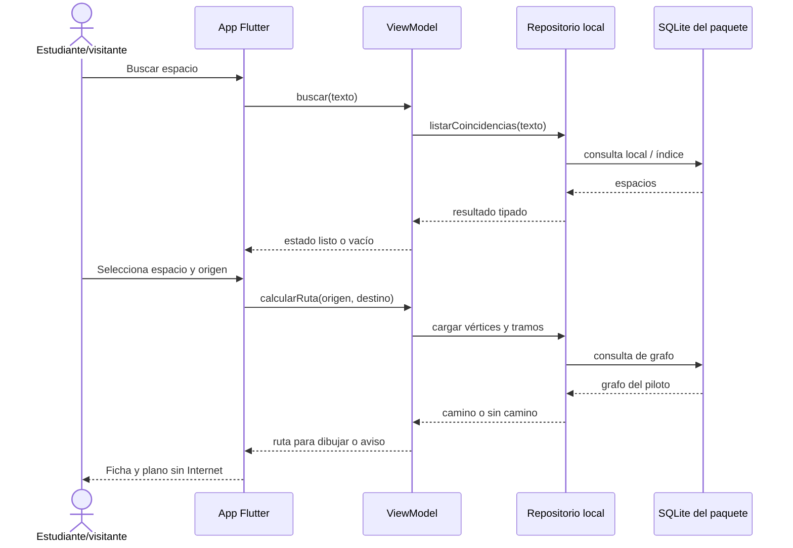

# Planificación de sprints · UniPaz360

**Documento de trabajo para el curso DAM · UNIPAZ 2026** 
**Base consultada:** `main` remoto, commit `5262cb7` (21 oct 2026); clon local en `examen/sprint1-tecnico`, commit `b2db285` (14 oct 2026). 
**Horizonte:** Sprint 2, Sprint 3 y, como máximo, dos sprints de continuación (Sprint 4 y Sprint 5). Sin fechas calendario: la duración prevista por el README es una semana por sprint, sujeta a confirmación del curso.

> **Entregables de la evaluación (solo tres):** consulta [12-entregables-finales.md](12-entregables-finales.md). Los sprints y tareas de este documento son los pasos de trabajo para producir esos tres resultados, no entregables adicionales.

> Este plan organiza el producto UniPaz360. El PDF de EcoReporte se usa únicamente como referencia para presentar actores, eventos, flujos y capas. No se trasladan de él funcionalidades, actores, datos ni decisiones de producto.

## 1. Resumen ejecutivo

UniPaz360 debe ayudar a estudiantes nuevos y visitantes a encontrar un espacio del Centro de Investigaciones Santa Lucía y llegar a él sin depender de conexión. El repositorio remoto ya no es solo la prueba INV-04 de lista y ficha: en `main` es un monorepo con app Flutter, datos de ejemplo, esquema central PostgreSQL/PostGIS, scripts de validación y empaquetado, documentación ampliada y una experiencia de visor institucional. Aun así, el flujo Must completo de búsqueda → ficha → origen → ruta calculada sobre datos reales → plano offline no queda demostrado por la presencia de archivos o pantallas aisladas.

La planificación propone primero cerrar alcance y requisitos (Sprint 2), después asegurar una base integrada y verificable (Sprint 3), completar el recorrido Must con datos del bloque piloto (Sprint 4) y reservar Sprint 5 como sprint final de estabilización, pruebas en dispositivo y demostración. **La fecha de entrega no puede prometerse todavía:** los CSV de `datos/piloto/` están vacíos y la implementación integrada de grafo, SQLite y navegación de rutas debe verificarse. Si el Sprint 4 no cierra la ruta completa, Sprint 5 no puede declararse “demo final completa” sin replanificar alcance o capacidad.

### Resultado final que se busca

Una versión Android que, con un paquete de campus instalado y en modo avión, permita buscar un espacio por nombre/código, consultar su ficha, elegir el origen, calcular y dibujar una ruta a pie sobre el plano del bloque piloto; informa cuando el destino o el camino no están disponibles. Se verificará con tareas de usuario y el objetivo publicado de 90 % de tareas sin ayuda y menos de 60 segundos para buscar y calcular una ruta. La ruta sin escaleras se mantiene como Should en el backlog vigente, aunque aparece en la visión del producto: requiere decisión explícita del PO antes de anunciarla como parte de la entrega.

## 2. Diagnóstico del proyecto

### 2.1 Estado observado

| Área | Evidencia en `main` remoto | Estado que se puede afirmar | Brecha para el MVP |
|---|---|---|---|
| App Flutter | `app/`, Flutter, `material_ui`, Provider, go_router; modelos y módulos de espacios, sesión, dron, recientes y visor 360 | App y pantallas de demostración existentes; `main` incluye recorrido institucional, mapa visual y visor de muestra | Verificar en Android qué flujos están accesibles. En el router consultado `/espacios` y `/espacios/:id` redirigen a `/`, por lo que lista/ficha no están integradas como destino navegable en esa versión. |
| Sesión y alcance | `main` tiene pantalla/ruta de ingreso y sesión local; el README dice que este semestre no hay cuentas ni datos personales | Código de sesión existe; requerimiento en conflicto | Resolver D-02 antes de decidir si el ingreso es bloqueante del MVP. No ampliar autenticación ni horarios por inferencia. |
| Espacios | repositorio simulado y cinco ejemplos; ViewModel publica cargando/vacío/error/listo | Prueba local de estados y datos de ejemplo | No equivale al catálogo del piloto ni a búsqueda desde SQLite. |
| Mapa | foto aérea local, controles y puntos demostrativos documentados como simulados/estáticos | Orientación visual de muestra | La ruta trazada en demostración no es cálculo sobre un grafo real; origen por QR y selector real siguen pendientes según análisis cartográfico. |
| 360° | motor y pantalla de muestra, imagen de ejemplo | Capacidad de visualización de muestra | No confirma recorrido multipanorámico ni paquete offline del piloto. Es Should, no bloquea el MVP Must. |
| Datos | `datos/ejemplo/` poblado; `datos/piloto/*.csv` sin levantamiento real (según la documentación revisada) | Plantilla/ejemplo y formato definido | Falta inventario de campo autorizado, plano alineado, conectividad del grafo y validación por responsables del campus. |
| Pipeline | `scripts/validar.mjs`, `empaquetar.mjs`, `pruebas.mjs`; reglas para IDs, referencias, conectividad, accesibilidad, QR, horarios y SHA-256 | Herramientas de servidor/local y prueba del paquete de ejemplo | Falta demostrar que el paquete real se instala/consulta desde Flutter offline. La guía indica SQLite+manifest; verificarla con ejecución y resultado CI actuales. |
| Base central | migraciones/semilla PostgreSQL + PostGIS en `db/`; conexión protegida por variables de entorno | Estructura y scripts documentados; la app no consulta directamente Neon | No es requisito para uso offline del MVP. No ejecutar migraciones reales sin entorno, respaldo y autorización de quien administra la base. |
| Panel | `panel/README.md` reserva la fase futura y declara que todavía no hay código | Solo documentación | Excluido del alcance del semestre vigente. |
| CI y calidad | `.github/workflows/ci.yml` y README describen controles por carpeta | Configuración declarada | Confirmar ejecuciones recientes del commit que se vaya a liberar; el plan no presume que hoy estén verdes. |

### 2.2 Diferencia entre remoto y copia local

El directorio de trabajo actual está en `examen/sprint1-tecnico` (`b2db285`) y solo conoce `origin/main` hasta `3b6bca6`; no contiene `app/`, `panel/`, `db/` ni `scripts/`. El remoto `main` avanzó hasta `5262cb7` (`feat: recorrido institucional UNIPAZ 360 y mapa interactivo`, 21 oct 2026). Hay cambios sustanciales posteriores que no están en este clon. Por tanto:

- Este plan toma `main@5262cb7` como la referencia funcional remota para el diagnóstico.
- Antes de implementar, el equipo debe sincronizar y revisar conflictos; no copiar archivos de remoto a ciegas ni trabajar sobre la base antigua como si fuera actual.
- La carpeta local ya contiene `docs/evidencias/` sin seguimiento. Se conserva intacta; no forma parte de este documento ni se incluye en staging.

### 2.3 Alcance de producto que rige este plan

El README y el backlog vigentes dicen: Android, Centro Santa Lucía, piloto por bloque, funcionamiento offline, sin seguimiento interior continuo; sin panel web este semestre. El MVP Must suma 37 puntos de un backlog de 79. Deben mantenerse fuera del MVP salvo decisión expresa del PO: iOS/escritorio, otras sedes, panel, voz, posicionamiento continuo y horarios/sistema académico. QR, ruta accesible, distancia/tiempo, sincronización, distribución APK y visor 360° son Should; no deben desplazar la ruta Must.

**Decisión de alcance pendiente D-01:** la visión promete ruta sin escaleras, pero MoSCoW la clasifica como Should (HU-07). El PO y el docente deben decidir si se eleva a Must con validación real de accesibilidad, o si se limita la promesa del MVP. Una ruta solo puede etiquetarse accesible después de verificación en campo.

## 3. Actores, eventos y flujos

### 3.1 Actores y sistemas

| Actor / sistema | Necesidad y responsabilidad | Interacción incluida |
|---|---|---|
| Estudiante nuevo | Encontrar aula/oficina y recorrer una ruta clara | Buscar, abrir ficha, fijar origen y seguir ruta offline. |
| Visitante/aspirante | Confirmar que el espacio es el indicado y orientarse | Buscar, revisar bloque/nivel/horario y consultar ruta. |
| Persona con movilidad reducida | Evitar escaleras y barreras | Solo cuando HU-07 esté aprobada y los tramos estén inspeccionados; si no hay ruta verificada, informar sin prometer accesibilidad. |
| PO | Ordena alcance, valida criterios y acepta historias | Prioriza, toma D-01 y acepta la revisión de sprint. |
| Equipo de desarrollo (3 integrantes) | Mantener app, datos y automatización | Divide tareas por capacidad real; límites Kanban vigentes: WIP 3 desarrollo y WIP 2 revisión. |
| Usuario validador | Representa estudiante nuevo/visitante en pruebas | Ejecuta tareas y reporta problemas; solicitar consentimiento y no registrar datos personales innecesarios. |
| Responsable de campus / levantamiento | Confirma nombres, ubicación, horarios, plano y barreras | Fuente de verdad para el piloto; su participación está pendiente de confirmar. |
| GitHub Actions | Ejecuta controles automatizados de cambios | Flutter analyze/test y validación de datos según las rutas afectadas. |
| PostgreSQL/PostGIS central y empaquetador | Mantienen/validan la publicación del dataset | Componentes del ecosistema planificado; la app consume un paquete local, no consulta directamente la base central. |

Los usuarios no obtienen permisos administrativos en el MVP. El ingreso institucional que aparece en la app es un punto en conflicto con README y debe resolverse mediante D-02; no se supone que la autenticación externa esté operativa.

El trazo punteado identifica la integración central prevista por la documentación; el flujo de extremo a extremo hasta la app aún requiere prueba. El panel administrativo queda fuera y no aparece como actor que ya publique datos.

### 3.2 Eventos y respuesta esperada

| ID | Evento | Datos/contexto | Resultado esperado | Fallos que se deben cubrir | Historia |
|---|---|---|---|---|---|
| EV-01 | Usuario abre “Buscar” | Consulta vacía o texto | Catálogo listo sin requerir red | Paquete ausente/dañado: aviso de datos no disponibles y recuperación definida | HU-01 |
| EV-02 | Usuario escribe nombre o código | Texto normalizado, coincidencias | Lista ordenada que muestra nombre, código y bloque | Sin coincidencias: estado vacío con limpiar/buscar otra vez | HU-01 |
| EV-03 | Usuario toca resultado | ID estable | Ficha correcta: categoría, bloque, nivel, horario y foto/placeholder | ID no encontrado o medio ausente: aviso legible; no pantalla en blanco | HU-02 |
| EV-04 | Usuario elige origen | ID de vértice/espacio válido | Origen visible y distinto del destino | Origen inexistente, igual al destino o sin conexión: indicar causa y permitir corregir | HU-03/HU-04 |
| EV-05 | Usuario solicita ruta | Origen, destino y preferencia | Camino mínimo calculado sobre tramos permitidos y conectado al plano | Sin camino: explicar que no existe ruta; datos inconsistentes: no inventar trazado | HU-04 |
| EV-06 | App dibuja ruta | Lista ordenada de vértices/tramos y nivel | Ruta visible sobre plano alineado, con origen y destino distinguibles | Plano o geometría no disponible: error recuperable, no ruta falsa | HU-05/TEC-10 |
| EV-07 | App se inicia sin red | Paquete previamente instalado | Buscar/ficha/ruta siguen operativos en modo avión | Instalación incompleta/versiones incompatibles: instrucción clara para recuperar datos | TEC-02/TEC-07/HU-09 |
| EV-08 | Usuario solicita ruta accesible | Perfil sin escaleras | Ruta formada solo por tramos inspeccionados/verificados | No existe: informar que no se pudo verificar ruta accesible; ofrecer volver a ruta normal | HU-07, si D-01 la incluye |
| EV-09 | Usuario escanea QR | URI estable y cámara | Origen resuelto sin internet | QR desconocido, ilegible o cámara denegada: selección manual disponible | HU-06, fase posterior |

### 3.3.1 Requerimientos funcionales por flujo

| Flujo | Comportamiento incluido | Alternos/errores | Alcance |
|---|---|---|---|
| Buscar y ficha | Catálogo local, consulta por nombre/código, abrir espacio por ID, mostrar campos descriptivos | Vacío, datos dañados, ID eliminado | Must HU-01/02 |
| Orientarse y llegar | Elegir origen, calcular sobre grafo y dibujar sobre plano de piloto | Origen inválido, origen igual al destino, grafo sin conexión, plano ausente | Must HU-03/04/05 |
| Uso sin red | Leer base local instalada; la red no es dependencia de la tarea principal | Paquete no instalado/corrupto, versión incompatible | Must TEC-02; actualización HU-09 se mantiene Should |
| Accesibilidad de ruta | Filtrar tramos solo si la inspección y decisión lo permiten | Sin camino accesible verificado | Should HU-07, decisión D-01 |
| Recorrido virtual | Visor de imágenes locales y navegación entre panorámicas | Activo faltante/dañado | Should HU-10; muestra existe, recorrido multipanorámico pendiente |
| Autenticación/horarios | No forma parte del flujo Must según README vigente | Código de sesión y pantalla de ingreso en `main` contradicen alcance; decidir D-02 | No ampliar hasta decisión PO/docente |

### 3.4 Flujo principal y alternos

## 4. Plan por sprint

La política del README permite hasta seis elementos en “Listo” por sprint y WIP 3 en desarrollo. Las tareas de abajo se deben convertir en issues pequeños; no superar dichos límites. Puntos de backlog originales se conservan, no se recalculan. El equipo de tres personas rota revisión y mantiene el PR revisado por alguien distinto a quien lo hizo.

### Sprint 2 · Requisitos, actores, eventos, flujos y arquitectura

**Objetivo:** dejar requisitos y arquitectura del MVP trazables y validados, resolver contradicciones de alcance y preparar trabajo implementable para el Sprint 3. El sprint no se acepta por crear más documentos: requiere revisión del PO y al menos una validación con usuario/representante disponible.

**Estado/dependencias:** los documentos `docs/plan/` y `docs/sprints/sprint-01.md` aportan base; el último describe Sprint 1 como investigación/prototipo, mientras que la rama `examen/sprint1-tecnico` contiene INV-04 técnico. Confirmar con docente cuál es la secuencia oficial de sprints. Depende de sincronizar el clon y de confirmar los Must del README. Depende del responsable del campus para datos del piloto; si no está disponible, registrar bloqueo y no fabricar ubicaciones.

#### Historias y criterios de aceptación

| Historia | Criterios verificables |
|---|---|
| S2-01 · Alcance (HU-S2-01) | **Como PO**, quiero fijar qué entra en la entrega y aclarar las diferencias entre examen, README y `main`, **para** que el equipo construya la versión que evaluará el curso. **Prioridad:** alta. **Dependencia:** revisión del docente/equipo. **Prueba:** acta que resuelve/eleva D-01 (HU-07), D-02 (sesión) y numeración de sprint; ninguna contradicción se oculta. |
| S2-02 · Criterios del recorrido (HU-S2-02) | **Como estudiante nuevo**, quiero que búsqueda, ficha, origen y ruta tengan resultados y errores definidos, **para** saber qué esperar al orientarme. **Prioridad:** alta. **Dependencia:** criterios Must vigentes. **Prueba:** revisión guiada que demuestra criterios de éxito, vacío, error, offline y Atrás para HU-01…05. |
| S2-03 · Contratos y eventos (HU-S2-03) | **Como desarrollador**, quiero conocer entradas, estados, salidas y errores de cada capa, **para** integrar UI, repositorio local y paquete sin acoplarlos. **Prioridad:** alta. **Dependencia:** HU-S2-02. **Prueba:** revisión por otro integrante de la tabla de eventos y contratos; cada error tiene respuesta observable. |
| S2-04 · Arquitectura actual/objetivo (HU-S2-04) | **Como equipo**, queremos separar lo existente de lo propuesto en frontend, dominio, persistencia y pipeline, **para** tomar decisiones técnicas justificadas. **Prioridad:** alta. **Dependencia:** auditoría de `main`. **Prueba:** diagramas revisados contra rutas/clases; no hay integración dibujada como terminada si no está probada. |
| S2-05 · Preparar piloto (HU-S2-05) | **Como visitante**, quiero que los nombres, ubicación y barreras de los espacios estén confirmados, **para** seguir indicaciones fiables. **Prioridad:** alta. **Dependencia:** permiso y responsable del campus. **Prueba:** plan de levantamiento aprobado o bloqueo explícito; nunca reemplazar datos reales por ubicaciones inventadas. |

#### Tareas técnicas

| ID | Tarea | Descripción técnica | Responsable o perfil | Prioridad | Dependencia | Entregable | Criterio de finalización |
|---|---|---|---|---|---|---|---|
| S2-T01 | Alinear clon | Comparar SHA local/remoto, historial y diferencias; preservar archivos no rastreados y crear rama desde base acordada | SM + revisor | Alta | Acceso GitHub | Registro de baseline y rama | Base/commit se acuerdan y evidencia previa permanece intacta |
| S2-T02 | Conciliar fuentes | Comparar README, tablero, docs de sprints/examen y registrar numeración/alcance oficial | PO | Alta | T01 | Acta de decisiones | Se anotan acuerdos, responsables y preguntas pendientes |
| S2-T03 | Definir requisitos | Refinar HU-01…05, actores, eventos y escenarios alternos | PO + developer | Alta | T02 | Historias trazables | Cada historia tiene criterio de aceptación y prueba |
| S2-T04 | Auditar navegación | Recorrer rutas Flutter y distinguir widget existente de flujo accesible integrado | Developer 1 | Alta | T01 | Informe con capturas/checks | Lista de rutas confirmada en código y en ejecución o marcada sin verificar |
| S2-T05 | Validar arquitectura | Documentar capas actuales/objetivo, paquete local, pipeline y CI; separar realidad de propuesta | Developer 2 | Alta | T03/T04 | `docs/arquitectura.md` | Revisión técnica y diagramas coherentes con el repo |
| S2-T06 | Resolver piloto/accesibilidad | Confirmar permiso de campo, responsable, límites de zona y decisión HU-07 | PO + equipo | Bloqueante para S4 | Campus/docente | D-01 y plan de campo o bloqueo | No se afirma ruta accesible ni datos reales sin validación |

**Entregables:** decisión de alcance; historias HU-01…05 listas y criterios; actores/eventos/flujos; arquitectura con límites actuales y propuestos; plan de levantamiento de piloto; tablero actualizado con dependencias.

**Validación/evidencia:** revisión PO; recorrido de prototipo con al menos estudiante nuevo/visitante si se puede convocar; minuta con observaciones sin identificadores personales; links de issues/PR; diagramas versionados. Si no se logra convocar usuario o campus, registrarlo como impedimento, no como prueba completada.

**Aceptación del sprint:** criterios y diagramas revisados por equipo; D-01 decidido o bloqueado con fecha/rol de resolución; no quedan historias Must sin definición de offline/errores; alcance oficial de Sprint 2 confirmado. **DoD Sprint 2:** artefactos fusionados por PR revisado, links coherentes, sin duplicar ni reemplazar evidencia previa, tablero refleja decisiones y bloqueos.

### Sprint 3 · Base integrada y vertical slice técnico

**Objetivo:** pasar de pantallas/repositorios de muestra y pipeline separado a una ruta técnica reproducible: paquete real de prueba → almacenamiento/consulta local → lista/ficha navegables; dejar el contrato de grafo/ruta listo para la siguiente rebanada.

**Estado/dependencias:** Sprint 2 aprobado; app remota sincronizada; datos de piloto disponibles o uso claramente rotulado de `datos/ejemplo/`. TEC-01/04/05 aparecen implementados parcialmente en estructura y scripts; no se reabren salvo fallas. TEC-02 exige repositorio SQLite con pruebas; la generación de SQLite por script no demuestra por sí sola consumo de SQLite en Flutter.

#### Historias y criterios de aceptación

| Historia | Criterios verificables |
|---|---|
| S3-01 · Lista navegable (HU-S3-01) | **Como estudiante nuevo**, quiero abrir la lista de espacios, **para** comenzar la búsqueda desde la app. **Prioridad:** Must. **Dependencia:** S2 y router sincronizado. **Prueba:** navegación de `/espacios`, contenido, Atrás; no redirige a inicio. |
| S3-02 · Datos offline (HU-S3-02) | **Como visitante**, quiero consultar el catálogo local, **para** encontrar lugares aunque no tenga señal. **Prioridad:** Must. **Dependencia:** TEC-02/04/05 y paquete válido. **Prueba:** catálogo desde SQLite en modo avión, sin llamadas de red. |
| S3-03 · Búsqueda y ficha (HU-S3-03) | **Como visitante**, quiero buscar y abrir ficha, **para** confirmar el lugar. **Prioridad:** Must. **Dependencia:** S3-01/02. **Prueba:** nombre, código, vacío, horario y placeholder de imagen. |
| S3-04 · Datos inválidos (HU-S3-04) | **Como usuario**, quiero saber si los datos locales no son válidos, **para** no recibir una ubicación falsa. **Prioridad:** alta. **Dependencia:** paquete/manifest. **Prueba:** hash, esquema o referencia dañada bloquea catálogo/ruta y produce error recuperable. |
| S3-05 · Contrato del grafo (HU-S3-05) | **Como desarrollador**, quiero probar los casos límite del grafo, **para** que la ruta se comporte correctamente al conectarse al piloto. **Prioridad:** alta. **Dependencia:** TEC-04 y datos de fixture. **Prueba:** origen=destino, vértice inexistente, desconectado y filtro de tramos. |

#### Tareas técnicas

| ID | Tarea | Descripción técnica | Responsable o perfil | Prioridad | Dependencia | Entregable | Criterio de finalización |
|---|---|---|---|---|---|---|---|
| S3-T01 | Verificar entorno y CI | Anotar Flutter/Dart/Node/Android usados; ejecutar checks en el baseline y documentar fallas del entorno aparte de fallas de código | SM + revisor | Alta | S2 aprobado | Registro de versiones/checks por SHA | Checks reproducibles o impedimentos aislados y asignados |
| S3-T02 | Integrar navegación | Conectar las rutas a lista/ficha respetando el flujo aprobado y Atrás | Developer 1 | Must | S3-T01 | Rutas accesibles | Pruebas de navegación pasan; no redirect inesperado |
| S3-T03 | Implementar repositorio local | Abrir SQLite local, mapear entidades y manejar versión/esquema sin SQL en Widgets | Developer 2 | Must | TEC-04/paquete | Adaptador y migración | Pruebas de consulta, inexistente y esquema inválido pasan |
| S3-T04 | Implementar búsqueda | Consultar nombre/código con índice disponible, vacío y normalización acordada | Developer 1 | Must | T02/T03 | Búsqueda conectada a UI | Casos de coincidencia, acento y sin resultados pasan |
| S3-T05 | Validar paquete | Consumir manifest/hash, validar versión y fallar de modo recuperable; probar instalación/rollback definida | Developer 2 + SM | Alta | Scripts existentes y SQLite | Paquete ejemplo reproducible | Hash alterado no se acepta y no deja DB parcial visible |
| S3-T06 | Separar demo de piloto | Mantener fixtures de ejemplo identificables y preparar archivos piloto sin rellenar valores ficticios | PO + campus | Alta | Acceso al responsable | Dataset claramente etiquetado | Ninguna fixture se confunde con dato validado de campo |

**Entregables:** flujo lista/ficha integrado; repositorio local comprobable; paquete de ejemplo consumido en modo avión; contrato documentado de grafo; CI enlazado al commit.

**Validación/evidencia:** pruebas de repositorio/UI para carga, búsqueda, ficha, vacío y paquete inválido; instalar APK en Android físico cuando esté disponible, activar modo avión, repetir lista/ficha; guardar versión y SHA del APK/commit. `flutter analyze`, `flutter test` y scripts deben quedar verdes para los cambios cubiertos.

**Aceptación del sprint:** no existen redirects que bloqueen HU-01/02; lista/ficha leen una fuente SQLite definida; ejemplo sin red pasa; una prueba demuestra fallo de hash/esquema recuperable. **DoD Sprint 3:** PR revisado, CI verde, pruebas pasan, documentación de migración/contrato actualizada. Si solo funciona el mock, no aceptar como integración offline.

### Sprint 4 · Vertical slice de navegación con bloque piloto

**Objetivo:** conectar origen, cálculo del camino mínimo y plano real alineado para un bloque del Centro Santa Lucía; terminar todas las historias Must de Encontrar/Llegar que tengan datos suficientes.

**Estado/dependencias:** Sprint 3 aceptado; levantamiento INV-01 completo, aprobado y con grafo conexo; TEC-10 plano alineado; identificación de rutas accesibles confirmada si D-01 las elevó. Sin esta base no hay condición para completar ruta real: el equipo puede seguir con fixtures, pero solo contará como prueba técnica.

#### Historias y criterios de aceptación

| Historia | Criterios verificables |
|---|---|
| S4-01 · Elegir origen (HU-03) | **Como estudiante nuevo**, quiero elegir desde dónde salgo, **para** obtener una ruta pertinente. **Prioridad:** Must. **Dependencia:** S3 y vértices piloto. **Prueba:** cambiar origen mantiene destino; inválido e igual al destino se manejan. |
| S4-02 · Calcular camino (HU-04) | **Como estudiante nuevo**, quiero calcular el camino más corto a pie, **para** llegar al espacio. **Prioridad:** Must. **Dependencia:** grafo conexo y métrica acordada. **Prueba:** fixture con ruta conocida, igual origen/destino y sin camino. |
| S4-03 · Ver plano y ruta (HU-05) | **Como estudiante nuevo**, quiero ver el camino sobre el plano del bloque, **para** seguirlo en campus. **Prioridad:** Must. **Dependencia:** TEC-10 calibrado y HU-04. **Prueba:** referencias espaciales conocidas coinciden en Android; no usa línea fija demo. |
| S4-04 · Validar recorrido (INV-01) | **Como visitante**, quiero probar el flujo con datos reales del piloto, **para** confirmar que puedo llegar sin ayuda. **Prioridad:** Must. **Dependencia:** permiso y APK con paquete piloto. **Prueba:** medir tiempo, éxito y ayuda en modo avión; guardar muestra y resultado sin PII. |

#### Tareas técnicas

| ID | Tarea | Descripción técnica | Responsable o perfil | Prioridad | Dependencia | Entregable | Criterio de finalización |
|---|---|---|---|---|---|---|---|
| S4-T01 | Levantar bloque piloto | Completar archivos existentes con IDs/espacios/vértices/tramos/anclajes y horarios confirmados | PO + responsable campus + equipo | Must/bloqueante | Permiso y acceso | Dataset con fuente/fecha | Responsable confirma correspondencia; sin datos inventados |
| S4-T02 | Calibrar plano | Registrar puntos de referencia y transformación coordenada→imagen | Developer 1 + campo | Must | Plano y mediciones | Plano alineado TEC-10 | Referencias medidas coinciden dentro de tolerancia que el equipo documenta |
| S4-T03 | Empaquetar piloto | Ejecutar reglas, corregir bloqueos y generar SQLite/manifest/hash versionado | Developer 2 | Must | T01/T02 | Paquete reproducible | Validador sale sin errores; prueba de paquete verde |
| S4-T04 | Calcular rutas | Conectar selector/origen y algoritmo a datos locales | Developer 1 | Must | S3 y T01 | Servicio de camino mínimo | Casos de ruta conocida, igual origen y sin conexión pasan |
| S4-T05 | Dibujar camino | Convertir geometría del camino a coordenadas de plano y renderizar por nivel/escala | Developer 2 | Must | T02/T04 | Capa de ruta funcional | Puntos de control se alinean en los tamaños de pantalla objetivo |
| S4-T06 | Validar en campo | Recorrer rutas con responsable y registrar discrepancias de paso/obstáculo | Equipo + campus | Must | APK y piloto | Acta de recorrido | Discrepancias críticas corregidas; accesibilidad verificada solo si se inspecciona |

**Entregables:** paquete piloto versionado, validación reproducible, origen, ruta calculada y plano alineado para los destinos de alcance, registro de prueba de campo.

**Validación/evidencia:** pruebas de algoritmo en grafo conocido; prueba de desconectado; validación de paquete; capturas de lista/ficha/origen/ruta (con SHA y dispositivo identificado); ejecución en modo avión y contraste de al menos una ruta en campo.

**Aceptación del sprint:** las rutas aceptadas son derivadas del grafo y verificadas en el campus; ninguna pantalla rotula como “accesible” un tramo no inspeccionado; búsqueda + cálculo se mide; defectos críticos de orientación bloquean aceptación. **DoD Sprint 4:** análisis, tests, CI, revisión de código, APK Android y modo avión; datos en `datos/piloto/` con procedencia documentada.

### Sprint 5 · Sprint final: estabilización, aceptación y demostración

**Objetivo:** entregar un APK y paquete versionado reproducibles, integrar únicamente alcance aprobado que ya tenga dependencias resueltas, corregir bloqueadores y demostrar el MVP con usuarios. Este es el último sprint de este plan; no se abre otro sprint implícito.

**Estado/dependencias:** Sprint 4 cumple su aceptación y los casos Must funcionan con piloto. Si el grafo/plano o lista/ficha no han alcanzado ese punto, PO debe reducir alcance con docente o redefinir la entrega; no se marca “final” con mock.

#### Historias y criterios de aceptación

| Historia | Criterios verificables |
|---|---|
| S5-01 · Versión final en Android (HU-S5-01) | **Como equipo**, queremos instalar el APK con su paquete versionado y usarlo sin red, **para** demostrar el MVP. **Prioridad:** bloqueante. **Dependencia:** S4 aceptado. **Prueba:** flujo Must en modo avión en el dispositivo objetivo. |
| S5-02 · Recuperación (HU-S5-02) | **Como usuario**, quiero mensajes claros ante paquete ausente/corrupto o destino desconectado, **para** recuperarme sin indicaciones falsas. **Prioridad:** alta. **Dependencia:** S3/S4. **Prueba:** casos de daño y sin camino permiten corregir o salir sin cierre inesperado. |
| S5-03 · Aceptación (HU-S5-03) | **Como PO**, quiero medir tareas y tiempo con usuarios representativos, **para** conocer si se alcanza el objetivo de producto. **Prioridad:** alta. **Dependencia:** APK/piloto y consentimiento. **Prueba:** informar n, éxitos, necesidad de ayuda, tiempos y resultado ante 90 %/60 s. |
| S5-04 · Evidencia de entrega (HU-S5-04) | **Como docente/evaluador**, quiero localizar el APK, SHA, documentación y resultados, **para** reproducir la demostración. **Prioridad:** alta. **Dependencia:** checks finales. **Prueba:** checklist de demo completo y enlaces resuelven a artefactos reales. |

#### Tareas técnicas

| ID | Tarea | Descripción técnica | Responsable o perfil | Prioridad | Dependencia | Entregable | Criterio de finalización |
|---|---|---|---|---|---|---|---|
| S5-T01 | Congelar alcance | Resolver HU-07, sesión/login y Should; documentar exclusiones | PO + docente | Bloqueante | Evidencia de S4 | Acta de alcance | No quedan Must ambiguos ni Should presentados como terminados |
| S5-T02 | Estabilizar Android | Revisar permisos, lifecycle, Atrás, tamaños/semántica básica y errores offline | Developer 1 | Alta | S4 aceptado | APK candidato | Instala y completa casos de prueba sin defectos bloqueantes |
| S5-T03 | Congelar paquete | Regenerar desde fuente versionada y probar integridad/recuperación | Developer 2 | Alta | T01 y paquete piloto | Versión + manifest/hash | Hash/versiones coherentes; restauración/carga comprobada |
| S5-T04 | Verificar calidad | Ejecutar analyzer, tests, scripts, build Android y workflow del SHA final | SM + revisor | Bloqueante | T02/T03 | Registro de CI y salidas | Todo pasa; si hay falla queda corregida o entrega no se acepta |
| S5-T05 | Aceptar en dispositivo | Usar Android físico en modo avión para recorrer casos Must y alternos | Equipo | Bloqueante | APK/paquete final | Matriz de resultados y capturas autorizadas | Resultados registrados en el mismo SHA/version y sin red |
| S5-T06 | Preparar demo | Ensayar flujo, recuperación, restricciones y alternativa sin servicio externo | PO + equipo | Alta | T04/T05 | Guion, README y checklist | Demo se repite desde estado limpio y explica limitaciones |

**Entregables:** APK de demostración, commit/tag o release aprobado por el equipo, paquete con hashes, documentación, reporte de pruebas y checklist de demo.

**Validación/evidencia:** resultado CI asociado al SHA, salida `flutter analyze`, salida `flutter test`, salida de scripts, build APK, prueba real en modo avión, fotos/capturas de app con datos autorizados y tabla de resultados de usuario. No se publican rostros, nombres ni ubicaciones sensibles sin consentimiento.

**Aceptación final:** todas las Must que el PO haya mantenido en alcance pasan sus criterios; APK no depende de servicios en red para navegación; paquete reproduce la misma experiencia; objetivos de 90 %/60 s se reportan con muestra y limitaciones. Si objetivo no se cumple, declarar incumplimiento y causa; no afirmar que pasó.

**DoD final:** código fusionado por PR revisado; CI verde en commit de entrega; análisis y tests verdes; APK instalado físicamente y probado offline; datos piloto aprobados y rastreables; errores conocidos documentados; material de demo y evidencias vinculados; aceptación explícita PO/docente.

## 5. Arquitectura: actual, transición y destino del semestre

### Decisión de frontend, backend y almacenamiento

El cliente implementado es Flutter con Material UI, Provider/ChangeNotifier y go_router. Para el alcance Must offline no se justifica añadir un servidor API que la app tenga que consultar en tiempo real: el diseño documentado usa PostgreSQL/PostGIS como fuente central de administración/publicación y un paquete SQLite versionado que el teléfono consulta localmente. El panel no tiene código y el README lo excluye este semestre. La publicación/descarga por HTTPS (TEC-07/HU-09) está en Should y puede habilitarse después sin convertir el servidor en dependencia de búsqueda/ruta.

Por ello, Sprint 3 debe verificar el contrato de paquete y su consumo real en Flutter; no se planifican endpoints nuevos de backend para el MVP. Se mantienen las credenciales fuera del repositorio. Cualquier activación de Neon, R2, Google institucional o publicación real requiere responsable, variables protegidas y decisión explícita. Para datos geográficos, el esquema central documenta PostGIS y las coordenadas del grafo; la navegación de la app se resuelve sobre los tramos/vertices locales, sin presuponer GPS interior ni teselas en línea. El ER fuente central está en `docs/plan/03-datos-y-publicacion.md` y `db/`; el esquema de dispositivo está en `docs/datos/esquema.sql`.

**Capas propuestas para el cliente:** presentación (widgets y navegación); aplicación (ViewModels, estado y casos de uso); dominio (Espacio, Vértice, Tramo, Paquete); datos (implementaciones de repositorio SQLite/archivo y simulados solo para pruebas); plataforma (archivos, cámara QR cuando se apruebe, permisos). Los widgets consumen ViewModel, no repositorios. Los scripts y la base central son herramientas de publicación, no consultas directas de la app.

**Transición que debe demostrarse:** el repositorio remoto tiene un repositorio simulado para espacios y genera SQLite en el pipeline; hace falta probar e integrar el adaptador local. En la app actual el home es el visor institucional y la ruta vieja de espacios redirige al inicio. Los diagramas describen el objetivo de los sprints y no certifican que ese ensamblaje ya exista.

### Secuencia offline del MVP

## 6. Matriz de trazabilidad

Estados usados: **hecho parcial** = existe pieza, pero falta integración/aceptación; **pendiente** = no se encontró evidencia suficiente; **planificado** = futuro documentado. Actualizar tras verificar CI y app física.

| Requerimiento | Actor relacionado | Evento o flujo | Componente arquitectónico | Sprint | Historia de usuario | Prueba de validación | Estado |
|---|---|---|---|---|---|---|---|
| TEC-01 · app/CI | equipo | PR y compilación | Flutter, GitHub Actions | S2–S3 | HU-S3-01 | Build/analyze/tests en SHA de PR | Hecho parcial; verificar checks actuales |
| TEC-06 · arquitectura | equipo | decisiones técnicas | módulos app y docs | S2 | HU-S2-04 | Revisión cruzada del diagrama y rutas | Parcial; completar/integrar documento de curso |
| TEC-04 · esquema | equipo | datos del espacio/grafo | dominio, SQLite, db central | S2–S3 | HU-S2-04/HU-S3-05 | Migración y contrato coherentes | Parcial; hay esquemas, falta verificación consumo |
| TEC-02 · repositorio SQLite | estudiante/visitante | buscar offline | repositorio Flutter + SQLite | S3 | HU-S3-02 | Consulta sin red, casos de esquema | Pendiente de demostrar en Flutter |
| INV-01 · bloque piloto | campus/usuarios | preparación del dataset | CSV `datos/piloto` | S2–S4 | HU-S2-05/HU-S4-04 | Revisión de procedencia, conectividad y validación | Pendiente; plantilla sin datos reales |
| TEC-05 · pipeline | equipo/campus | validar y empaquetar | scripts Node + SQLite/manifest | S3–S4 | HU-S3-04 | Pruebas script y paquete generado | Hecho parcial; herramienta existe, falta piloto |
| TEC-10 · plano alineado | usuario | mostrar ruta | renderer y geometría local | S4 | HU-05 | Puntos de control/recorrido en campus | Pendiente de verificar |
| HU-01 · búsqueda | estudiante/visitante | EV-01/02 | UI, ViewModel, repositorio | S3 | HU-S3-03 | Nombre, código, vacío, modo avión | Parcial en mock; ruta no integrada |
| HU-02 · ficha | visitante | EV-03 | UI detalle, dominio Espacio | S3 | HU-S3-03 | Campos, placeholder, id desconocido | Parcial; ruta actual redirige |
| HU-03 · origen | estudiante | EV-04 | UI, ViewModel, repositorio | S4 | HU-03 | Selección/cambio/inválido | Pendiente |
| HU-04 · camino más corto | estudiante | EV-05 | caso de uso/algoritmo, grafo local | S4 | HU-04 | Ruta conocida, igual origen, desconectado | Pendiente; trazo fijo demo no es cálculo |
| HU-05 · ruta sobre plano | estudiante | EV-06 | plano y renderer | S4 | HU-05 | Alineación y recorrido físico | Parcial visual; integración real pendiente |
| TEC-03 · distribución | equipo/evaluador | instalar release | build Android/canal distribución | S5 opcional | HU-S5-01 | Descargar/instalar artefacto firmado o documentar local | Should; decisión pendiente |
| HU-06/INV-03 · QR | estudiante | EV-09 | cámara, parser URI, origen | posterior | HU-06 | Prueba Android offline, luz/placa | Pendiente; fuera Must |
| HU-07 · accesible | movilidad reducida | EV-08 | grafo con atributos verificados | D-01/S4 si se eleva | HU-07 | Auditoría en campo, no escaleras y ruta conexa | Should y bloqueado por decisión/datos |
| HU-08 · distancia/tiempo | estudiante | resultado de ruta | dominio de ruta/UI | posterior | HU-08 | Distancia y estimación contrastadas | Pendiente; Should |
| TEC-07/HU-09 · actualización | usuario | descarga de paquete nuevo | HTTPS, versionado, almacenamiento | posterior | HU-09 | Hash, corte de red y rollback | Parcial de tooling; cliente pendiente; Should |
| INV-02/HU-10 · 360 | aspirante | recorrido virtual | motor 360, activos locales | posterior | HU-10 | 3 panorámicas offline/uso medido | Muestra implementada; recorrido completo pendiente |
| HU-11 · piso por piso | estudiante | ruta entre niveles | grafo, niveles, renderer | futuro | HU-11 | Conectores verticales y planos por nivel | Could; pendiente |
| HU-12 · enlace 360 | aspirante | panorámica a ficha/ruta | visor, router y espacio | futuro | HU-12 | Deep link a ficha/ruta correctas | Could; pendiente |
| HU-13 · reportar error | usuario | error de dato/ruta | flujo de reporte/servicio | futuro | HU-13 | Envío seguro y respuesta responsable | Could; fuera alcance actual |
| HU-14 · baja visión | baja visión | lectura de UI | widgets/semantics | S5 mínimo/futuro completo | HU-14 | escalado y lector de pantalla en Android | Could; sin conformidad acreditada |
| Login/horarios (D-02) | usuario institucional | ingreso y consulta | sesión local/servicios | S2 decisión | HU-S2-01 | Aceptación PO/docente del alcance | Código presente; alcance contradice README |
| Panel web | administrador futuro | edición/publicación | panel reservado | fuera del semestre | — | Confirmar que no bloquea MVP | Sin código; F3 futuro |

## 7. Riesgos, supuestos y preguntas abiertas

| Riesgo/decisión | Prob. / impacto | Respuesta y responsable |
|---|---|---|
| Clon local obsoleto respecto a `main` | Alta / alto: integrar sobre base equivocada o sobrescribir evidencia | SM actualiza desde remoto aprobado y compara antes de crear rama; preservar evidencia existente. |
| Sin datos reales de piloto | Alta / crítico para ruta y prueba en campo | PO coordina acceso y responsable del campus antes de comprometer S4; fixtures solo sirven como prueba técnica. |
| HU-07 Must implícito en visión y Should en backlog | Media / alto y de seguridad | PO/docente decide D-01. No afirmar accesibilidad sin inspección. |
| Escala/plano no alineados | Media / alto | Medir referencia, validar con recorrido físico y repetir prueba en dispositivo. |
| SQLite generado pero no consumido por Flutter | Media / alto | Sprint 3 incluye integración real y prueba modo avión; mocks no son evidencia del producto. |
| Ramas documentales contradictorias sobre auth, panel, plataforma | Media / medio | Este plan conserva README/alcance del curso como límite; propuestas del plan ampliado requieren aprobación. |
| Compatibilidad de Flutter/Dart/paquetes | Media / alto | Fijar versiones usadas por el repo y ejecutar CI/build; no cambiar constraints sin revisar runner/Android Gradle. |
| Peso/compatibilidad de fotos 360 y plano | Media / medio | Dejar 360 fuera del camino crítico, medir APK y almacenamiento si se retoma. |
| Dependencia de nube/secretos | Baja para MVP offline / alto si se activa publicación | Secretos solo en variables protegidas; no ejecutar migración ni `--subir` en producción sin aprobación del responsable. |
| Muestra reducida de usuarios | Alta / medio | Reportar tamaño y resultados reales; 90 % no se generaliza con una muestra pequeña. |

### Preguntas para cerrar en Sprint 2

1. ¿El examen pide que el Sprint 2 sea documentación/arquitectura y Sprint 3 inicio del desarrollo, según el prompt de curso, o se debe renumerar a partir de los sprints del README? No mezclar la historia técnica INV-04 Sprint 1 con la numeración oficial sin confirmación docente.
2. ¿HU-07 se eleva a Must para cumplir la visión inclusiva o se reduce la promesa del MVP a ruta normal verificable?
3. ¿Quién autoriza el levantamiento y valida el plano/horarios reales del bloque piloto? ¿Qué zona se permite fotografiar y publicar?
4. ¿Cuál dispositivo Android físico y versión mínima se usarán para aceptación? ¿El equipo dispone de tres usuarios representantes para la prueba final?
5. ¿El curso exige publicación del APK por Firebase/App Distribution, o basta APK local con evidencia? TEC-03 está en Should.
6. ¿Qué PR/commit define el baseline de implementación para la evaluación: último `main` remoto o la rama `examen/sprint1-tecnico`?

## 8. Condiciones de éxito y cierre

El producto puede declararse listo para la demo del MVP cuando:

- El alcance aprobado está trazado a historias/criterios y no incluye panel, otras sedes ni seguimiento interior continuo.
- Las rutas de lista y detalle están conectadas al router y el repositorio Flutter consulta el paquete local real.
- INV-01 y TEC-10 describen un bloque autorizado, consistente y comprobado; el validador no reporta errores bloqueantes.
- Origen, grafo y plano producen rutas que el equipo ha recorrido en campus; los casos sin ruta son claros.
- APK y paquete se prueban sin conexión en Android físico; analyzer, pruebas y CI del SHA de entrega están verdes.
- Resultado de tareas se informa con datos de prueba reales, incluidos fallos y muestra; PO/docente aceptan explícitamente la entrega.

Si no hay dataset o acceso al campus, el Sprint 5 puede cerrar una **demo técnica con ejemplo**, pero no debe llamarse piloto real ni considerarse evidencia de navegación efectiva en Santa Lucía. El PO y docente deben aceptar por escrito ese alcance reducido antes de la presentación.

## 9. Checklist de demo

- [ ] Indicar versión, SHA del commit, dispositivo y versión Android.
- [ ] Instalar APK y activar modo avión antes de abrir la aplicación.
- [ ] Buscar un espacio por nombre y por código; mostrar coincidencia y estado sin resultados.
- [ ] Abrir ficha y explicar categoría, bloque, nivel, horario y placeholder de foto si aplica.
- [ ] Elegir un origen distinto, cambiarlo y mostrar el destino.
- [ ] Calcular ruta del paquete aprobado y señalar cómo coincide con el plano del bloque.
- [ ] Probar destino/origen iguales y caso sin conexión de grafo; mostrar mensajes de recuperación.
- [ ] Aclarar qué parte usa datos reales y qué parte es demostrativa; no llamar accesible a ruta no inspeccionada.
- [ ] Presentar evidencia de analyzer, tests, scripts y CI para el mismo SHA.
- [ ] Mostrar métrica de prueba de usuarios con tamaño de muestra, tiempo y tareas que fallaron.
- [ ] Cerrar con limitaciones conocidas y alcance excluido; dejar el APK/PR/release localizable.

## Fuentes de trabajo

- [Repositorio UniPaz360](https://github.com/mamalon104366/unipaz360) · `main@5262cb7` (21 oct 2026).
- [README y backlog](https://github.com/mamalon104366/unipaz360/blob/5262cb7/README.md).
- [Hoja de ruta](https://github.com/mamalon104366/unipaz360/blob/5262cb7/docs/plan/07-hoja-de-ruta.md).
- [Análisis funcional/cartográfico](https://github.com/mamalon104366/unipaz360/blob/5262cb7/docs/plan/08-analisis-funcional-y-arquitectura-cartografica.md).
- [Especificación de Sprint 1](https://github.com/mamalon104366/unipaz360/blob/5262cb7/docs/sprints/sprint-01.md).
- [Pipeline de datos](https://github.com/mamalon104366/unipaz360/blob/5262cb7/scripts/README.md) y [base central](https://github.com/mamalon104366/unipaz360/blob/5262cb7/db/README.md).
- PDF `EcoReporte · Actores, eventos y flujo + capas`: referencia de organización solicitada por el usuario; no es fuente de requisitos UniPaz360.
